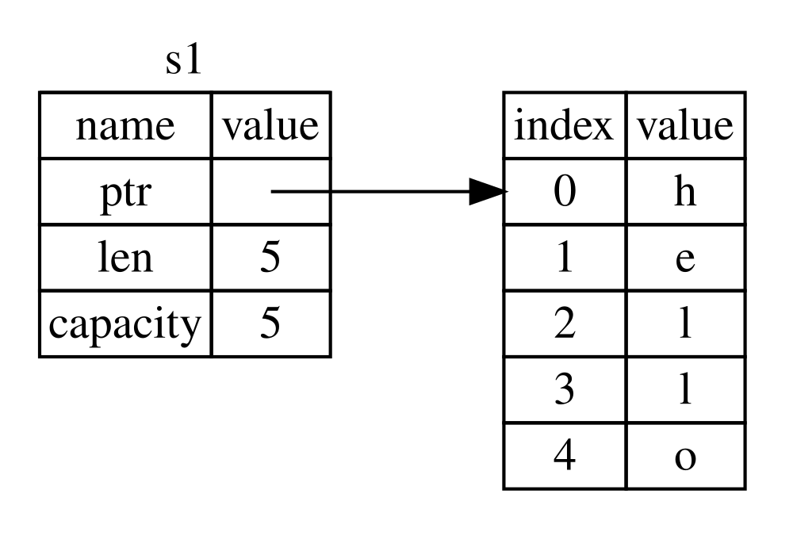
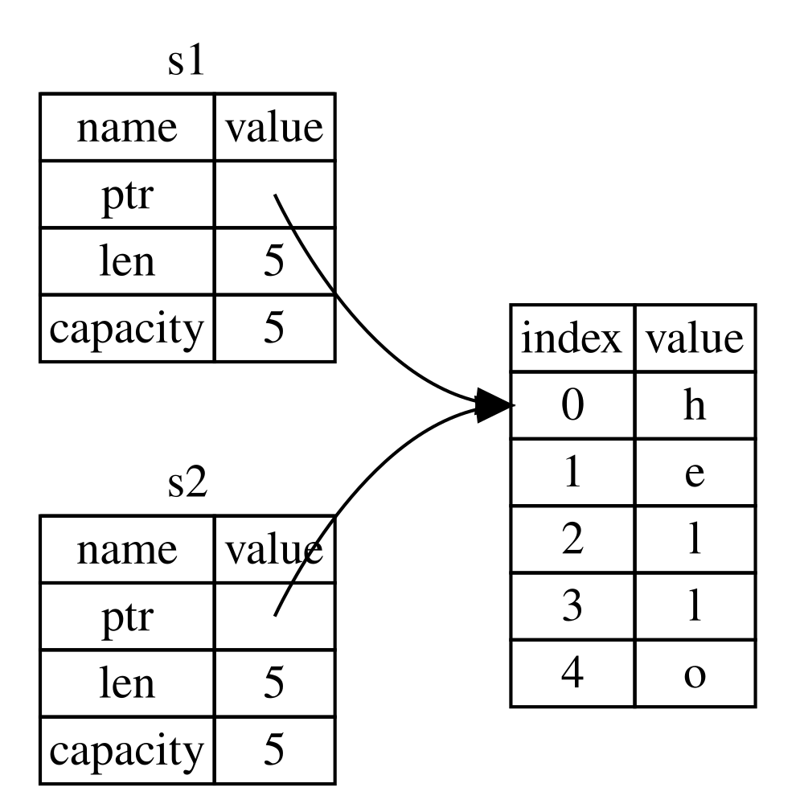
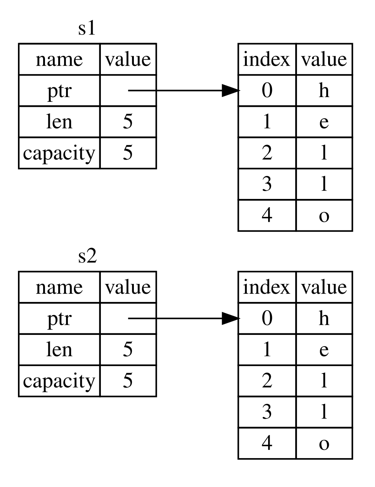
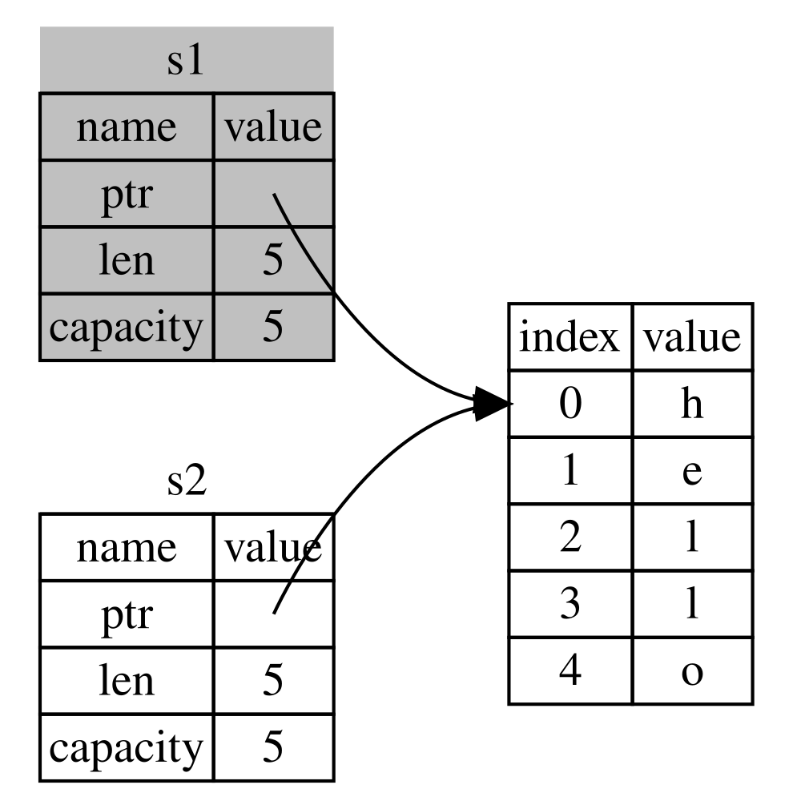
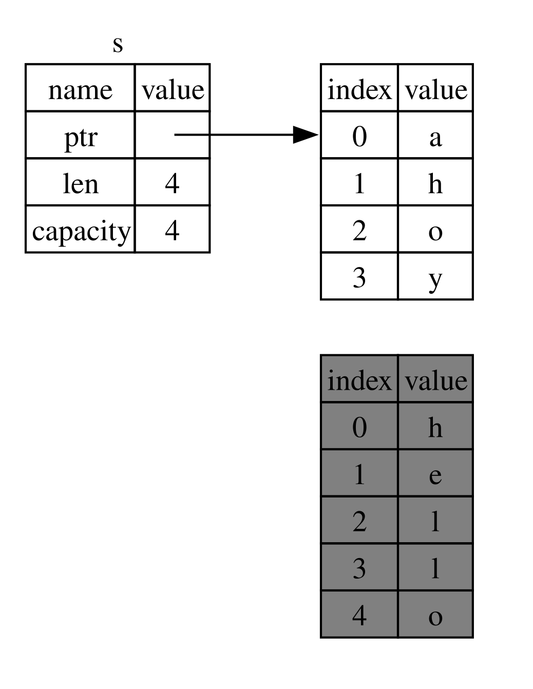

## Apa Itu Ownership?

_Ownership_ adalah kumpulan aturan yang mengatur cara program Rust mengelola
memori. Semua program harus mengelola cara mereka memakai memori komputer saat
berjalan. Beberapa bahasa punya garbage collector yang secara rutin mencari
memori yang sudah tidak terpakai selama program berjalan; di bahasa lain,
programmer harus mengalokasikan dan membebaskan memori secara eksplisit. Rust
memakai pendekatan ketiga: memori dikelola melalui sistem ownership dengan
seperangkat aturan yang diperiksa compiler. Jika ada aturan yang dilanggar,
program tidak akan terkompilasi. Tidak ada fitur ownership yang akan
memperlambat program kamu saat dijalankan.

Karena ownership adalah konsep baru bagi banyak programmer, memang butuh waktu
untuk membiasakan diri. Kabar baiknya, makin lama kamu mahir dengan Rust dan
aturan sistem ownership, makin mudah kamu menulis kode yang aman dan efisien
secara alami. Terus berlatih!

Setelah kamu paham ownership, kamu akan punya dasar yang kuat untuk memahami
fitur-fitur yang membuat Rust unik. Di bab ini, kamu akan belajar ownership
lewat beberapa contoh yang berfokus pada struktur data yang sangat umum:
string.

> <a id="the-stack-and-the-heap"></a>
> ### Stack dan Heap
>
> Banyak bahasa pemrograman tidak menuntut kamu memikirkan stack dan heap
> terlalu sering. Tapi di bahasa pemrograman sistem seperti Rust, apakah sebuah
> nilai berada di stack atau heap memengaruhi cara bahasa itu berperilaku dan
> alasan kamu harus mengambil keputusan tertentu. Beberapa bagian ownership
> akan dijelaskan berkaitan dengan stack dan heap di bagian akhir bab ini, jadi
> berikut penjelasan singkat sebagai bekal.
>
> Stack dan heap sama-sama bagian memori yang bisa dipakai kode kamu saat
> runtime, tapi keduanya disusun dengan cara berbeda. Stack menyimpan nilai
> sesuai urutan diterimanya dan menghapus nilai dengan urutan terbalik. Ini
> disebut _last in, first out (LIFO)_, atau masuk terakhir, keluar pertama.
> Bayangkan tumpukan piring: saat kamu menambah piring, kamu meletakkannya di
> atas tumpukan, dan saat butuh piring, kamu mengambilnya dari puncak. Menambah
> atau mengambil piring dari tengah atau bawah tumpukan tidak akan praktis!
> Menambah data disebut _pushing onto the stack_, dan menghapus data disebut
> _popping off the stack_. Semua data yang disimpan di stack harus berukuran
> tetap dan diketahui. Data yang ukurannya tidak diketahui saat kompilasi atau
> bisa berubah harus disimpan di heap.
>
> Heap lebih tidak teratur: saat kamu menaruh data di heap, kamu meminta
> sejumlah ruang. Alokator memori menemukan ruang kosong di heap yang cukup
> besar, menandainya sedang dipakai, lalu mengembalikan sebuah _pointer_, yaitu
> alamat lokasi tersebut. Proses ini disebut _allocating on the heap_ dan kadang
> disingkat hanya _allocating_ (mendorong nilai ke stack tidak dianggap
> mengalokasikan). Karena pointer ke heap berukuran tetap dan diketahui, kamu
> bisa menyimpan pointer itu di stack; tapi saat kamu ingin data yang
> sebenarnya, kamu harus mengikuti pointer itu. Bayangkan kamu sedang duduk di
> restoran. Saat masuk, kamu menyebut berapa orang di rombonganmu, lalu petugas
> meja menemukan meja kosong yang muat untuk semuanya dan mengantar kalian ke
> sana. Jika ada anggota rombonganmu yang datang terlambat, dia bisa bertanya
> di mana kalian duduk untuk menemukanmu.
>
> Mendorong ke stack lebih cepat daripada mengalokasikan di heap karena alokator
> tidak perlu mencari tempat menyimpan data baru; lokasinya selalu di puncak
> stack. Sebaliknya, mengalokasikan ruang di heap butuh lebih banyak kerja
> karena alokator harus lebih dulu menemukan ruang yang cukup besar untuk
> menampung data, lalu melakukan pencatatan agar alokasi berikutnya siap.
>
> Mengakses data di heap umumnya lebih lambat daripada mengakses data di stack
> karena kamu harus mengikuti pointer untuk mencapainya. Prosesor modern lebih
> cepat jika melompat-lompat di memori lebih sedikit. Menjawaskan analogi
> tersebut, bayangkan seorang pelayan di restoran mencatat pesanan dari banyak
> meja. Paling efisien mengambil semua pesanan di satu meja dulu sebelum pindah
> ke meja berikutnya. Mengambil pesanan dari meja A, lalu meja B, lalu A lagi,
> lalu B lagi akan jauh lebih lambat. Dengan logika yang sama, prosesor biasanya
> bekerja lebih baik jika memproses data yang berdekatan dengan data lain
> (seperti di stack) ketimbang yang jauh (seperti bisa terjadi di heap).
>
> Saat kode kamu memanggil sebuah fungsi, nilai yang diteruskan ke fungsi itu
> (termasuk, bisa jadi, pointer ke data di heap) dan variabel lokal fungsi akan
> didorong ke stack. Setelah fungsi selesai, nilai-nilai itu dikeluarkan dari
> stack.
>
> Melacak bagian kode mana yang memakai data apa di heap, meminimalkan jumlah
> data duplikat di heap, dan membersihkan data yang tidak terpakai di heap
> supaya ruangmu tidak habis—semua itu adalah masalah yang diatasi oleh
> ownership. Setelah kamu paham ownership, kamu tidak akan terlalu sering
> memikirkan stack dan heap. Tapi mengetahui bahwa tujuan utama ownership
> adalah mengelola data heap bisa membantu menjelaskan mengapa ia bekerja
> sebagaimana ia bekerja.

### Aturan Ownership

Pertama, mari kita lihat aturan ownership. Ingatlah aturan-aturan ini sambil
kita menelaah contoh-contoh yang menggamparkannya:

- Setiap nilai di Rust memiliki _owner_ (pemilik).
- Pada satu waktu, hanya boleh ada satu owner.
- Saat owner keluar dari scope, nilai itu akan di-drop.

### Scope Variabel

Karena kita sudah melampaui sintaks dasar Rust, kita tidak akan menyertakan
seluruh kode `fn main() {` pada contoh, jadi kalau kamu mengikuti, pastikan
memasukkan contoh-contoh berikut ke dalam fungsi `main` secara manual. Dengan
begitu, contoh kita jadi lebih ringkas, sehingga kita fokus pada detail yang
sebenarnya, bukan kode boilerplate.

Sebagai contoh pertama tentang ownership, kita akan melihat scope dari beberapa
variabel. _Scope_ adalah rentang di dalam program tempat sebuah item berlaku.
Perhatikan variabel berikut:

```rust
let s = "hello";
```

Variabel `s` merujuk ke string literal, yaitu string yang nilainya di-hardcode
ke dalam teks program kita. Variabel itu berlaku sejak titik deklarasinya sampai
akhir scope saat ini. Listing 4-1 menunjukkan sebuah program dengan komentar
yang menandai di mana variabel `s` berlaku.

<Listing number="4-1" caption="Sebuah variabel dan scope tempatnya berlaku">

```rust
{{#rustdoc_include ../listings/ch04-understanding-ownership/listing-04-01/src/main.rs:here}}
```

</Listing>

Dengan kata lain, ada dua momen penting di sini:

- Saat `s` _masuk_ scope, ia berlaku.
- Ia tetap berlaku sampai _keluar_ dari scope.

Sampai di sini, hubungan antara scope dan masa berlaku variabel sama saja
dengan bahasa pemrograman lain. Sekarang kita bangun di atas pemahaman itu
dengan memperkenalkan tipe `String`.

### Tipe `String`

Untuk menggambarkan aturan ownership, kita butuh tipe data yang lebih kompleks
daripada yang sudah kita bahas di bagian [“Tipe Data”][data-types]<!-- ignore -->
di Bab 3. Tipe-tipe yang sudah dibahas berukuran tetap dan diketahui, bisa
disimpan di stack lalu dikeluarkan dari stack saat scope-nya selesai, dan bisa
disalin dengan cepat serta mudah untuk membuat instance baru yang independen
jika bagian kode lain perlu memakai nilai yang sama di scope berbeda. Tapi kita
ingin melihat data yang disimpan di heap dan menelusuri bagaimana Rust tahu
kapan harus membersihkan data itu, dan tipe `String` adalah contoh yang tepat.

Kita akan fokus pada bagian `String` yang berkaitan dengan ownership. Aspek-aspek
ini juga berlaku untuk tipe data kompleks lain, baik yang disediakan standard
library maupun yang kamu buat sendiri. Kita akan membahas aspek `String` yang
bukan soal ownership di [Bab 8][ch8]<!-- ignore -->.

Kita sudah melihat string literal, yaitu nilai string yang di-hardcode ke dalam
program kita. String literal praktis, tapi tidak cocok untuk setiap situasi
tempat kita ingin memakai teks. Salah satu alasannya, string literal itu
immutable. Alasan lain, tidak semua nilai string bisa kita ketahui saat menulis
kode: misalnya, bagaimana kalau kita ingin menerima input pengguna lalu
menyimpannya? Untuk situasi seperti itulah Rust menyediakan tipe `String`. Tipe
ini mengelola data yang dialokasikan di heap sehingga mampu menyimpan jumlah teks
yang tidak kita ketahui saat kompilasi. Kamu bisa membuat `String` dari string
literal memakai fungsi `from`, seperti ini:

```rust
let s = String::from("hello");
```

Operator dua titik dua `::` memungkinkan kita menempatkan fungsi `from` ini di
dalam namespace tipe `String`, alih-alih memakai semacam nama seperti
`string_from`. Sintaks ini akan kita bahas lebih lanjut di bagian
[“Method”][methods]<!-- ignore --> di Bab 5, serta saat kita membahas
namespace bersama module di [“Path untuk Merujuk ke Item di Pohon
Module”][paths-module-tree]<!-- ignore --> di Bab 7.

String seperti ini _bisa_ dimutasi:

```rust
{{#rustdoc_include ../listings/ch04-understanding-ownership/no-listing-01-can-mutate-string/src/main.rs:here}}
```

Lalu, apa bedanya? Kenapa `String` bisa dimutasi tapi literal tidak? Bedanya
terletak pada cara kedua tipe ini menangani memori.

### Memori dan Alokasi

Pada string literal, kita tahu isinya sejak saat kompilasi, jadi teksnya
di-hardcode langsung ke executable final. Itulah sebabnya string literal cepat
dan efisien. Tapi sifat itu hanya berasal dari sifat immutable string literal.
Sayangnya, kita tidak bisa menaruh segumpal memori ke dalam binary untuk setiap
potongan teks yang ukurannya tidak diketahui saat kompilasi dan bisa berubah
selama program berjalan.

Dengan tipe `String`, untuk menopang teks yang mutable dan bisa bertambah, kita
perlu mengalokasikan sejumlah memori di heap—yang tidak diketahui saat
kompilasi—untuk menampung isinya. Artinya:

- Memori harus diminta dari alokator memori saat runtime.
- Kita butuh cara mengembalikan memori ini ke alokator setelah selesai memakai
  `String` kita.

Bagian pertama dilakukan oleh kita: saat kita memanggil `String::from`,
implementasinya meminta memori yang dibutuhkannya. Hal ini berlaku di hampir
semua bahasa pemrograman.

Namun, bagian kedua berbeda. Di bahasa yang memiliki _garbage collector (GC)_,
GC melacak dan membersihkan memori yang sudah tidak terpakai, dan kita tidak
perlu memikirkannya. Di sebagian besar bahasa tanpa GC, kitalah yang bertanggung
jawab menandai kapan memori sudah tidak dipakai lalu memanggil kode untuk
membebaskannya secara eksplisit, sama seperti saat kita memintanya.
Melakukannya dengan benar secara historis adalah masalah pemrograman yang sulit.
Jika kita lupa, memori terbuang. Jika terlalu cepat, kita dapat variabel yang
tidak valid. Jika melakukannya dua kali, itu juga bug. Kita harus memasangkan
tepat satu `allocate` dengan tepat satu `free`.

Rust menempuh jalan lain: memori dikembalikan secara otomatis begitu variabel
pemiliknya keluar dari scope. Berikut versi contoh scope kita dari Listing 4-1
yang memakai `String` alih-alih string literal:

```rust
{{#rustdoc_include ../listings/ch04-understanding-ownership/no-listing-02-string-scope/src/main.rs:here}}
```

Ada titik alami tempat kita bisa mengembalikan memori yang dibutuhkan `String`
kita ke alokator: saat `s` keluar dari scope. Ketika sebuah variabel keluar
dari scope, Rust memanggil fungsi khusus untuk kita. Fungsi itu bernama `drop`,
dan di sanalah penulis `String` bisa menaruh kode untuk mengembalikan memori.
Rust memanggil `drop` secara otomatis di kurung kurawal penutup.

> Catatan: Di C++, pola melepas resource di akhir lifetime sebuah item ini
> kadang disebut _Resource Acquisition Is Initialization (RAII)_. Fungsi `drop`
> di Rust akan terasa familiar bagimu jika kamu sudah memakai pola RAII.

Pola ini berdampak besar pada cara kode Rust ditulis. Sekarang mungkin terlihat
sederhana, tapi perilaku kode bisa tak terduga pada situasi yang lebih rumit
ketika kita ingin beberapa variabel memakai data yang kita alokasikan di heap.
Mari kita telusuri beberapa situasi itu sekarang.

<!-- Old headings. Do not remove or links may break. -->

<a id="ways-variables-and-data-interact-move"></a>

<a id="variables-and-data-interacting-with-move"></a>
#### Variabel dan Data yang Berinteraksi dengan Move

Beberapa variabel bisa berinteraksi dengan data yang sama dengan cara berbeda
di Rust. Listing 4-2 menunjukkan contoh yang memakai integer.

<Listing number="4-2" caption="Menugaskan nilai integer variabel `x` ke `y`">

```rust
{{#rustdoc_include ../listings/ch04-understanding-ownership/listing-04-02/src/main.rs:here}}
```

</Listing>

Kita mungkin bisa menebak apa yang dilakukan kode ini: “Ikat nilai `5` ke `x`;
lalu, salin nilai di `x` dan ikatkan ke `y`.” Sekarang kita punya dua variabel,
`x` dan `y`, dan keduanya bernilai `5`. Memang begitu yang terjadi, karena
integer adalah nilai sederhana berukuran tetap yang diketahui, dan dua nilai
`5` itu didorong ke stack.

Sekarang mari lihat versi `String`:

```rust
{{#rustdoc_include ../listings/ch04-understanding-ownership/no-listing-03-string-move/src/main.rs:here}}
```

Tampilannya sangat mirip, jadi kita mungkin mengira cara kerjanya sama: baris
kedua akan menyalin nilai di `s1` lalu mengikatnya ke `s2`. Tapi bukan begitu
yang sebenarnya terjadi.

Perhatikan Gambar 4-1 untuk melihat apa yang terjadi pada `String` di balik
layar. `String` terdiri atas tiga bagian, ditampilkan di sebelah kiri: pointer
ke memori yang menampung isi string, sebuah length, dan sebuah capacity.
Kelompok data ini disimpan di stack. Di sebelah kanan adalah memori di heap
yang menampung isinya.



<span class="caption">Gambar 4-1: Representasi dalam memori sebuah `String`
yang memegang nilai `"hello"` yang terikat ke `s1`</span>

Length adalah seberapa banyak memori, dalam byte, yang saat ini dipakai isi
`String` itu. Capacity adalah total memori, dalam byte, yang diterima `String`
dari alokator. Perbedaan antara length dan capacity itu penting, tapi bukan
dalam konteks ini, jadi untuk sekarang abaikan saja capacity-nya.

Saat kita menugaskan `s1` ke `s2`, data `String` disalin, artinya kita menyalin
pointer, length, dan capacity yang ada di stack. Kita tidak menyalin data di
heap yang dirujuk pointer itu. Dengan kata lain, representasi data dalam memori
tampak seperti Gambar 4-2.



<span class="caption">Gambar 4-2: Representasi dalam memori variabel `s2` yang
memiliki salinan pointer, length, dan capacity dari `s1`</span>

Representasinya _bukan_ seperti Gambar 4-3, yang merupakan tampilan memori jika
Rust justru menyalin data heap juga. Jika Rust melakukan itu, operasi
`s2 = s1` bisa sangat mahal dari sisi performa runtime jika data di heap besar.



<span class="caption">Gambar 4-3: Kemungkinan lain tentang apa yang dilakukan
`s2 = s1` jika Rust juga menyalin data heap</span>

Tadi kita sudah bilang, saat variabel keluar dari scope, Rust otomatis memanggil
fungsi `drop` dan membersihkan memori heap untuk variabel itu. Tapi Gambar 4-2
menunjukkan kedua pointer data menunjuk ke lokasi yang sama. Ini masalah: saat
`s2` dan `s1` keluar dari scope, keduanya akan berusaha membebaskan memori yang
sama. Ini dikenal sebagai error _double free_ dan merupakan salah satu bug
keamanan memori yang kita sebut sebelumnya. Membebaskan memori dua kali bisa
menyebabkan korupsi memori, yang berpotensi menimbulkan kerentanan keamanan.

Untuk menjaga keamanan memori, setelah baris `let s2 = s1;`, Rust menganggap
`s1` tidak lagi valid. Karena itu, Rust tidak perlu membebaskan apa pun saat
`s1` keluar dari scope. Coba lihat apa yang terjadi saat kamu mencoba memakai
`s1` setelah `s2` dibuat; tidak akan jalan:

```rust,ignore,does_not_compile
{{#rustdoc_include ../listings/ch04-understanding-ownership/no-listing-04-cant-use-after-move/src/main.rs:here}}
```

Kamu akan mendapat error seperti ini karena Rust melarang kamu memakai
reference yang sudah tidak valid:

```console
{{#include ../listings/ch04-understanding-ownership/no-listing-04-cant-use-after-move/output.txt}}
```

Jika kamu pernah mendengar istilah _shallow copy_ dan _deep copy_ saat bekerja
dengan bahasa lain, konsep menyalin pointer, length, dan capacity tanpa menyalin
data mungkin terdengar seperti membuat shallow copy. Tapi karena Rust juga
meniadakan variabel pertama, alih-alih disebut shallow copy, hal ini dikenal
sebagai _move_. Pada contoh ini, kita akan bilang `s1` telah di-_move_ ke `s2`.
Jadi, yang benar-benar terjadi ditampilkan di Gambar 4-4.



<span class="caption">Gambar 4-4: Representasi dalam memori setelah `s1`
dinonaktifkan</span>

Masalah kita selesai! Dengan hanya `s2` yang valid, saat keluar dari scope
hanya dialah yang membebaskan memori, dan tugas pun selesai.

Selain itu, ada pilihan desain yang tersirat dari hal ini: Rust tidak akan
pernah membuat salinan “dalam” dari data kamu secara otomatis. Karena itu,
penyalinan _otomatis_ apa pun bisa diasumsikan murah dari sisi performa
runtime.

#### Scope dan Penugasan

Hal sebaliknya juga berlaku untuk hubungan antara scope, ownership, dan
pembebasan memori lewat fungsi `drop`. Saat kamu menugaskan nilai yang sama
sekali baru ke variabel yang sudah ada, Rust akan memanggil `drop` dan langsung
membebaskan memori nilai semula. Sebagai contoh, perhatikan kode ini:

```rust
{{#rustdoc_include ../listings/ch04-understanding-ownership/no-listing-04b-replacement-drop/src/main.rs:here}}
```

Awalnya kita deklarasikan variabel `s` dan mengikatnya ke `String` dengan nilai
`"hello"`. Lalu, kita segera membuat `String` baru dengan nilai `"ahoy"` dan
menugaskannya ke `s`. Saat ini, tidak ada lagi yang merujuk nilai asli di heap.
Gambar 4-5 mengilustrasikan data stack dan heap saat ini:



<span class="caption">Gambar 4-5: Representasi dalam memori setelah nilai awal
diganti sepenuhnya</span>

String asli itu pun segera keluar dari scope. Rust akan menjalankan fungsi `drop`
padanya dan memorinya langsung dibebaskan. Saat kita mencetak nilai di akhir,
hasilnya adalah `"ahoy, world!"`.

<!-- Old headings. Do not remove or links may break. -->

<a id="ways-variables-and-data-interact-clone"></a>

<a id="variables-and-data-interacting-with-clone"></a>
#### Variabel dan Data yang Berinteraksi dengan Clone

Jika kita _memang_ ingin menyalin data heap `String` secara mendalam, bukan
hanya data stack, kita bisa memakai method yang umum bernama `clone`. Kita akan
membahas sintaks method di Bab 5, tapi karena method adalah fitur yang umum di
banyak bahasa pemrograman, kamu mungkin sudah melihatnya sebelumnya.

Berikut contoh method `clone` dalam aksi:

```rust
{{#rustdoc_include ../listings/ch04-understanding-ownership/no-listing-05-clone/src/main.rs:here}}
```

Cara ini bekerja dengan baik dan secara eksplisit menghasilkan perilaku yang
ditampilkan di Gambar 4-3, di mana data heap _memang_ disalin.

Saat kamu melihat pemanggilan `clone`, kamu tahu ada kode sembarang yang
dijalankan dan kode itu bisa mahal. Itu penanda visual bahwa ada yang berbeda
sedang terjadi.

<a id="stack-only-data-copy"></a>
#### Data yang Hanya di Stack: Copy

Masih ada satu hal lagi yang belum kita bicarakan. Kode berikut yang memakai
integer—sebagiannya ditampilkan di Listing 4-2—bekerja dan valid:

```rust
{{#rustdoc_include ../listings/ch04-understanding-ownership/no-listing-06-copy/src/main.rs:here}}
```

Tapi kode ini sepertinya bertentangan dengan yang baru kita pelajari: kita tidak
memanggil `clone`, tapi `x` tetap valid dan tidak di-move ke `y`.

Alasannya, tipe seperti integer yang ukurannya diketahui saat kompilasi
disimpan seluruhnya di stack, sehingga menyalin nilai yang sebenarnya bisa
dilakukan dengan cepat. Artinya, tidak ada alasan untuk membuat `x` tidak valid
setelah kita membuat variabel `y`. Dengan kata lain, tidak ada bedanya antara
penyalinan mendalam dan dangkal di sini, jadi memanggil `clone` tidak akan
berbeda dari penyalinan dangkal biasa, dan kita bisa menghilangkannya.

Rust punya anotasi khusus bernama trait `Copy` yang bisa kita berikan pada tipe
yang disimpan di stack, seperti integer (kita akan membahas trait lebih lanjut
di [Bab 10][traits]<!-- ignore -->). Jika sebuah tipe mengimplementasikan trait
`Copy`, variabel yang menggunakannya tidak di-move, melainkan disalin begitu
saja, sehingga tetap valid setelah ditugaskan ke variabel lain.

Rust tidak akan membiarkan kita memberi anotasi `Copy` pada tipe yang, atau
bagian mana pun dari tipe itu, sudah mengimplementasikan trait `Drop`. Jika
tipe itu membutuhkan perlakuan khusus saat nilai keluar dari scope dan kita
menambahkan anotasi `Copy` pada tipe tersebut, kita akan dapat error waktu
kompilasi. Untuk mempelajari cara menambahkan anotasi `Copy` pada tipe kamu
agar mengimplementasikan trait itu, lihat
[“Trait yang Bisa Diturunkan”][derivable-traits]<!-- ignore --> di Lampiran C.

Jadi, tipe mana yang mengimplementasikan trait `Copy`? Kamu bisa memeriksa
dokumentasi tipe terkait untuk memastikannya, tapi sebagai aturan umum,
sekumpulan nilai skalar sederhana bisa mengimplementasikan `Copy`, sedangkan
apa pun yang membutuhkan alokasi atau berupa resource tidak bisa
mengimplementasikan `Copy`. Berikut beberapa tipe yang mengimplementasikan
`Copy`:

- Semua tipe integer, seperti `u32`.
- Tipe Boolean, `bool`, dengan nilai `true` dan `false`.
- Semua tipe floating-point, seperti `f64`.
- Tipe karakter, `char`.
- Tuple, jika hanya berisi tipe yang juga mengimplementasikan `Copy`. Sebagai
  contoh, `(i32, i32)` mengimplementasikan `Copy`, sedangkan `(i32, String)`
  tidak.

### Ownership dan Fungsi

Mekanisme meneruskan nilai ke sebuah fungsi mirip dengan saat menugaskan nilai
ke variabel. Meneruskan variabel ke fungsi akan meng-move atau menyalin, sama
seperti penugasan. Listing 4-3 berisi contoh dengan beberapa anotasi yang
menunjukkan di mana variabel masuk dan keluar dari scope.

<Listing number="4-3" file-name="src/main.rs" caption="Fungsi dengan ownership dan scope yang dianotasi">

```rust
{{#rustdoc_include ../listings/ch04-understanding-ownership/listing-04-03/src/main.rs}}
```

</Listing>

Jika kita mencoba memakai `s` setelah pemanggilan `takes_ownership`, Rust akan
melempar error waktu kompilasi. Pemeriksaan statis ini melindungi kita dari
kesalahan. Coba tambahkan kode di `main` yang memakai `s` dan `x` untuk melihat
di mana kamu bisa memakainya dan di mana aturan ownership melarangnya.

### Nilai Kembalian dan Scope

Mengembalikan nilai juga bisa memindahkan ownership. Listing 4-4 menunjukkan
contoh fungsi yang mengembalikan suatu nilai, dengan anotasi serupa seperti di
Listing 4-3.

<Listing number="4-4" file-name="src/main.rs" caption="Memindahkan ownership dari nilai kembalian">

```rust
{{#rustdoc_include ../listings/ch04-understanding-ownership/listing-04-04/src/main.rs}}
```

</Listing>

Ownership sebuah variabel selalu mengikuti pola yang sama: menugaskan nilai ke
variabel lain akan meng-move nilai itu. Saat variabel yang memuat data di heap
keluar dari scope, nilai itu akan dibersihkan oleh `drop` kecuali ownership
data sudah dipindahkan ke variabel lain.

Meski cara ini bekerja, mengambil ownership lalu mengembalikannya di setiap
fungsi terasa merepotkan. Bagaimana kalau kita ingin membiarkan sebuah fungsi
memakai nilai tanpa mengambil ownership? Cukup menjengkelkan jika apa pun yang
kita teruskan juga harus dikembalikan bila kita ingin memakainya lagi, di luar
data apa pun hasil dari badan fungsi yang mungkin ingin kita kembalikan juga.

Rust tetap membiarkan kita mengembalikan beberapa nilai dengan tuple, seperti
ditampilkan di Listing 4-5.

<Listing number="4-5" file-name="src/main.rs" caption="Mengembalikan ownership parameter">

```rust
{{#rustdoc_include ../listings/ch04-understanding-ownership/listing-04-05/src/main.rs}}
```

</Listing>

Tapi cara ini terlalu berbelit dan banyak kerja untuk sebuah konsep yang
seharusnya lazim. Untungnya, Rust punya fitur untuk memakai nilai tanpa
memindahkan ownership: reference.

[data-types]: ch03-02-data-types.html#data-types
[ch8]: ch08-02-strings.html
[traits]: ch10-02-traits.html
[derivable-traits]: appendix-03-derivable-traits.html
[methods]: ch05-03-method-syntax.html#methods
[paths-module-tree]: ch07-03-paths-for-referring-to-an-item-in-the-module-tree.html
