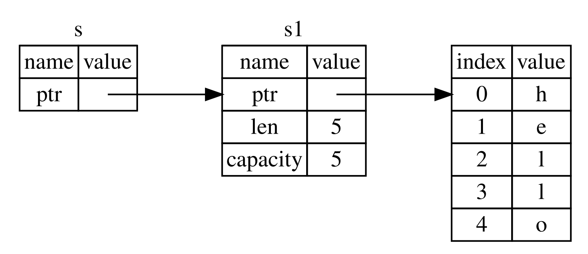

<a id="references-and-borrowing"></a>
## Reference dan Borrowing

Masalah pada kode tuple di Listing 4-5 adalah kita harus mengembalikan
`String` ke fungsi yang memanggilnya agar `String` itu masih bisa kita pakai
setelah pemanggilan `calculate_length`, karena `String`-nya sudah dipindahkan
ke dalam `calculate_length`. Sebagai gantinya, kita bisa memberikan *reference*
ke nilai `String` itu. Reference itu mirip pointer: keduanya berisi alamat yang
bisa kita ikuti untuk mengakses data tersimpan di alamat tersebut, dan data itu
dimiliki oleh variabel lain. Beda dengan pointer, reference dijamin menunjuk ke
nilai valid bertipe tertentu selama reference itu masih ada.

Begini cara kamu mendefinisikan dan memakai fungsi `calculate_length` yang
menerima reference ke sebuah objek sebagai parameter, alih-alih mengambil
ownership atas nilai tersebut:

<Listing file-name="src/main.rs">

```rust
{{#rustdoc_include ../listings/ch04-understanding-ownership/no-listing-07-reference/src/main.rs:all}}
```

</Listing>

Pertama, perhatikan bahwa seluruh kode tuple pada deklarasi variabel dan nilai
kembalian fungsi sudah hilang. Kedua, perhatikan bahwa kita mengoper `&s1` ke
`calculate_length` dan pada tanda tangannya kita memakai `&String` alih-alih
`String`. Tanda ampersand itu adalah reference; dengannya kamu bisa merujuk ke
suatu nilai tanpa mengambil ownership-nya. Gambar 4-6 menggambarkan konsep ini.



<span class="caption">Gambar 4-6: Diagram `&String` `s` yang menunjuk ke
`String` `s1`</span>

> Catatan: Kebalikan dari membuat reference dengan `&` adalah _dereferencing_,
> yang dilakukan dengan operator dereference, `*`. Kita akan melihat beberapa
> kegunaan operator dereference di Bab 8 dan membahas detail dereferencing di
> Bab 15.

Mari kita lihat lebih dekat pemanggilan fungsi di sini:

```rust
{{#rustdoc_include ../listings/ch04-understanding-ownership/no-listing-07-reference/src/main.rs:here}}
```

Sintaks `&s1` membuat reference yang _merujuk_ ke nilai `s1` tetapi tidak
memiliki nilai itu. Karena reference itu tidak memiliki nilainya, nilai yang
ditunjuknya tidak akan di-drop saat reference berhenti dipakai.

Begitu pula, tanda tangan fungsi memakai `&` untuk menunjukkan bahwa tipe
parameter `s` adalah reference. Mari kita tambahkan beberapa anotasi penjelas:

```rust
{{#rustdoc_include ../listings/ch04-understanding-ownership/no-listing-08-reference-with-annotations/src/main.rs:here}}
```

Scope tempat variabel `s` berlaku sama seperti scope parameter fungsi mana pun,
tetapi nilai yang ditunjuk reference tidak di-drop saat `s` berhenti dipakai,
karena `s` tidak memiliki ownership. Ketika fungsi menerima reference sebagai
parameter alih-alih nilai sebenarnya, kita tidak perlu mengembalikan nilai itu
untuk mengembalikan ownership, karena memang sejak awal kita tidak pernah
memilikinya.

Tindakan membuat reference kita sebut _borrowing_. Seperti dalam kehidupan
nyata: kalau seseorang memiliki sesuatu, kamu bisa meminjamnya darinya. Setelah
selesai, kamu harus mengembalikannya. Kamu bukan pemiliknya.

Lalu, bagaimana kalau kita mencoba memodifikasi sesuatu yang sedang kita
pinjam? Coba kode di Listing 4-6. Spoiler alert: kode itu tidak berhasil!

<Listing number="4-6" file-name="src/main.rs" caption="Mencoba memodifikasi nilai yang dipinjam">

```rust,ignore,does_not_compile
{{#rustdoc_include ../listings/ch04-understanding-ownership/listing-04-06/src/main.rs}}
```

</Listing>

Inilah error dari compiler:

```console
{{#include ../listings/ch04-understanding-ownership/listing-04-06/output.txt}}
```

Sama seperti variabel yang immutable secara default, reference juga begitu. Kita
tidak boleh memodifikasi sesuatu yang sedang kita rujuk.

### Reference Mutable

Kita bisa memperbaiki kode dari Listing 4-6 agar kita bisa memodifikasi nilai
yang dipinjam, cukup dengan beberapa perubahan kecil yang memakai sebuah
_reference mutable_:

<Listing file-name="src/main.rs">

```rust
{{#rustdoc_include ../listings/ch04-understanding-ownership/no-listing-09-fixes-listing-04-06/src/main.rs}}
```

</Listing>

Pertama, kita ubah `s` menjadi `mut`. Lalu, kita buat reference mutable dengan
`&mut s` di tempat kita memanggil fungsi `change`, dan memperbarui tanda tangan
fungsi agar menerima reference mutable lewat `some_string: &mut String`. Dengan
begitu, jelas sekali bahwa fungsi `change` akan memutasi nilai yang dipinjamnya.

Reference mutable punya satu pembatasan besar: kalau kamu punya reference
mutable ke suatu nilai, kamu tidak boleh punya reference lain ke nilai itu.
Kode berikut yang mencoba membuat dua reference mutable ke `s` akan gagal:

<Listing file-name="src/main.rs">

```rust,ignore,does_not_compile
{{#rustdoc_include ../listings/ch04-understanding-ownership/no-listing-10-multiple-mut-not-allowed/src/main.rs:here}}
```

</Listing>

Inilah error dari compiler:

```console
{{#include ../listings/ch04-understanding-ownership/no-listing-10-multiple-mut-not-allowed/output.txt}}
```

Error ini menyatakan bahwa kode itu tidak valid karena kita tidak bisa meminjam
`s` sebagai mutable lebih dari satu kali dalam satu waktu. Borrow pertama ada di
`r1` dan harus bertahan sampai `r1` dipakai di `println!`, tapi di antara
pembuatan reference mutable itu dan pemakaiannya, kita sudah mencoba membuat
reference mutable lain di `r2` yang meminjam data yang sama dengan `r1`.

Pembatasan yang melarang banyak reference mutable pada data yang sama di waktu
bersamaan tetap memungkinkan mutasi, hanya saja dengan cara yang sangat
terkendali. Hal ini sering membuat Rustacean baru kesulitan, karena di
kebanyakan bahasa kamu bebas memutasi kapan pun kamu mau. Keuntungan dari
pembatasan ini adalah Rust bisa mencegah data race saat kompilasi. Sebuah
_data race_ mirip dengan race condition dan terjadi ketika tiga hal berikut
terpenuhi:

- Dua pointer atau lebih mengakses data yang sama di waktu yang sama.
- Setidaknya satu dari pointer itu dipakai untuk menulis ke data tersebut.
- Tidak ada mekanisme apa pun yang dipakai untuk menyinkronkan akses ke data
  tersebut.

Data race menyebabkan undefined behavior dan bisa sulit didiagnosis serta
diperbaiki saat kamu menelusurinya di runtime; Rust mencegah masalah ini dengan
menolak mengompilasi kode yang mengandung data race!

Seperti biasa, kita bisa memakai kurung kurawal untuk membuat scope baru,
sehingga boleh ada banyak reference mutable—hanya saja tidak _bersamaan_:

```rust
{{#rustdoc_include ../listings/ch04-understanding-ownership/no-listing-11-muts-in-separate-scopes/src/main.rs:here}}
```

Rust memberlakukan aturan serupa untuk menggabungkan reference mutable dan
immutable. Kode berikut menghasilkan error:

```rust,ignore,does_not_compile
{{#rustdoc_include ../listings/ch04-understanding-ownership/no-listing-12-immutable-and-mutable-not-allowed/src/main.rs:here}}
```

Inilah error dari compiler:

```console
{{#include ../listings/ch04-understanding-ownership/no-listing-12-immutable-and-mutable-not-allowed/output.txt}}
```

Fiuh! Kita _juga_ tidak boleh punya reference mutable ketika kita sedang punya
reference immutable ke nilai yang sama.

Pengguna reference immutable tidak mengharapkan nilainya tiba-tiba berubah tanpa
mereka sadari! Namun, banyak reference immutable diizinkan karena siapa pun yang
hanya membaca data tidak dapat memengaruhi cara orang lain membaca data itu.

Perhatikan bahwa scope sebuah reference dimulai dari tempat reference itu
diperkenalkan dan berlanjut sampai terakhir kali reference itu dipakai. Sebagai
contoh, kode berikut akan terkompilasi karena pemakaian terakhir reference
immutable ada di `println!`, sebelum reference mutable diperkenalkan:

```rust
{{#rustdoc_include ../listings/ch04-understanding-ownership/no-listing-13-reference-scope-ends/src/main.rs:here}}
```

Scope reference immutable `r1` dan `r2` berakhir setelah `println!` tempat
terakhir kali keduanya dipakai, yaitu sebelum reference mutable `r3` dibuat.
Scope ini tidak saling tumpang tindih, jadi kode ini diizinkan: compiler bisa
melihat bahwa reference sudah tidak dipakai pada titik sebelum akhir scope.

Meski error borrowing kadang membuat frustrasi, ingatlah bahwa yang menunjukkan
potensi bug lebih awal adalah Rust compiler (saat kompilasi, bukan saat runtime)
dan menunjukkan tepat di mana masalahnya. Jadi, kamu tidak perlu menelusuri
mengapa data kamu bukan seperti yang kamu kira.

<a id="dangling-references"></a>
### Reference yang Menggantung

Di bahasa yang memakai pointer, mudah sekali membuat
_pointer menggantung_—pointer yang merujuk ke lokasi memori yang mungkin sudah
diberikan ke pihak lain—dengan membebaskan sebagian memori sambil tetap
menyimpan pointer ke memori itu. Di Rust, sebaliknya, compiler menjamin reference
tidak akan pernah menjadi reference yang menggantung: kalau kamu punya reference
ke suatu data, compiler memastikan data itu tidak keluar scope sebelum
reference-nya sendiri keluar scope.

Mari kita coba membuat reference yang menggantung untuk melihat bagaimana Rust
mencegahnya dengan error waktu kompilasi:

<Listing file-name="src/main.rs">

```rust,ignore,does_not_compile
{{#rustdoc_include ../listings/ch04-understanding-ownership/no-listing-14-dangling-reference/src/main.rs}}
```

</Listing>

Inilah error dari compiler:

```console
{{#include ../listings/ch04-understanding-ownership/no-listing-14-dangling-reference/output.txt}}
```

Pesan error ini menunjuk ke fitur yang belum kita bahas: lifetime. Kita akan
membahas lifetime secara detail di Bab 10. Tapi kalau kamu abaikan bagian
tentang lifetime, pesan itu tetap memuat kunci mengapa kode ini bermasalah:

```text
this function's return type contains a borrowed value, but there is no value
for it to be borrowed from
```

Mari kita lihat lebih dekat apa yang terjadi di setiap tahap kode `dangle`
kita:

<Listing file-name="src/main.rs">

```rust,ignore,does_not_compile
{{#rustdoc_include ../listings/ch04-understanding-ownership/no-listing-15-dangling-reference-annotated/src/main.rs:here}}
```

</Listing>

Karena `s` dibuat di dalam `dangle`, begitu kode `dangle` selesai, `s` akan
didealokasi. Tapi kita mencoba mengembalikan reference ke `s`. Artinya reference
itu akan menunjuk ke `String` yang tidak valid. Itu buruk! Rust tidak
membiarkan kita melakukan itu.

Solusinya di sini adalah mengembalikan `String` secara langsung:

```rust
{{#rustdoc_include ../listings/ch04-understanding-ownership/no-listing-16-no-dangle/src/main.rs:here}}
```

Cara ini berjalan tanpa masalah apa pun. Ownership dipindahkan keluar, dan tidak
ada yang didealokasi.

### Aturan Reference

Mari kita rangkum apa yang sudah kita bahas tentang reference:

- Pada satu waktu, kamu boleh punya _satu_ reference mutable _atau_ berapa pun
  banyaknya reference immutable.
- Reference harus selalu valid.

Selanjutnya, kita akan melihat jenis reference lain: slice.
