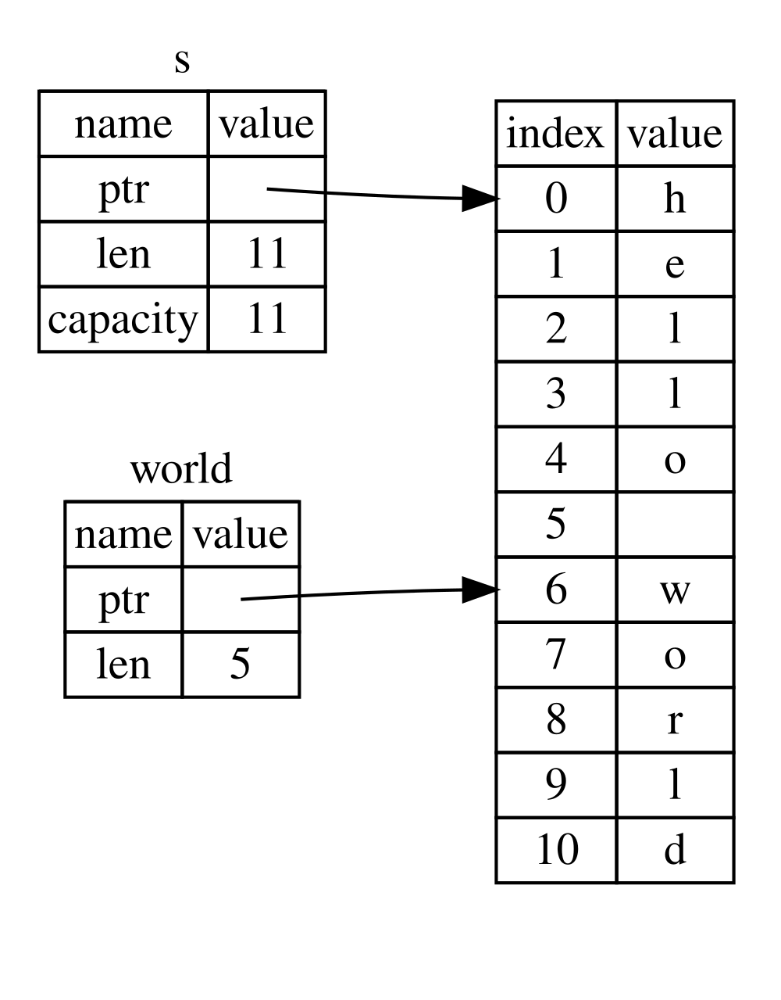

<a id="the-slice-type"></a>
## Tipe Slice

_Slices_ memungkinkan kamu mereferensikan urutan elemen yang berurutan di dalam
sebuah [collection](ch08-00-common-collections.md)<!-- ignore -->. Slice adalah
sejenis reference, sehingga tidak memiliki ownership.

Berikut sebuah masalah pemrograman kecil: tulis sebuah fungsi yang menerima
string berisi kata-kata yang dipisahkan spasi dan mengembalikan kata pertama
yang ditemukannya dalam string itu. Jika fungsi tidak menemukan spasi dalam
string, berarti seluruh string itu adalah satu kata, jadi seluruh string harus
dikembalikan.

> Catatan: Untuk keperluan pengenalan slice, kita berasumsi hanya ASCII di
> bagian ini; pembahasan lebih menyeluruh tentang penanganan UTF-8 ada di
> bagian ["Menyimpan Teks Berkode UTF-8 dengan String"][strings]<!-- ignore -->
> di Bab 8.

Mari kita telusuri bagaimana menulis tanda tangan fungsi ini tanpa menggunakan
slice, agar kamu memahami masalah yang akan diselesaikan oleh slice:

```rust,ignore
fn first_word(s: &String) -> ?
```

Fungsi `first_word` memiliki parameter bertipe `&String`. Kita tidak memerlukan
ownership, jadi itu tidak masalah. (Dalam Rust yang idiomatic, fungsi tidak
mengambil ownership dari argumennya kecuali memang perlu, dan alasannya akan
jelas seiring kita melanjutkan.) Tapi apa yang harus kita kembalikan? Kita
sebenarnya tidak punya cara untuk membahas *sebagian* dari sebuah string.
Namun, kita bisa mengembalikan indeks akhir kata yang ditandai sebuah spasi.
Mari kita coba cara itu, seperti yang ditunjukkan Listing 4-7.

<Listing number="4-7" file-name="src/main.rs" caption="Fungsi `first_word` yang mengembalikan nilai indeks byte ke dalam parameter `String`">

```rust
{{#rustdoc_include ../listings/ch04-understanding-ownership/listing-04-07/src/main.rs:here}}
```

</Listing>

Karena kita perlu menelusuri `String` elemen per elemen dan memeriksa apakah
sebuah nilai adalah spasi, kita akan mengubah `String` menjadi array byte
dengan metode `as_bytes`.

```rust,ignore
{{#rustdoc_include ../listings/ch04-understanding-ownership/listing-04-07/src/main.rs:as_bytes}}
```

Selanjutnya, kita membuat iterator di atas array byte dengan metode `iter`:

```rust,ignore
{{#rustdoc_include ../listings/ch04-understanding-ownership/listing-04-07/src/main.rs:iter}}
```

Kita akan membahas iterator lebih detail di [Bab 13][ch13]<!-- ignore -->.
Untuk sekarang, ketahuilah bahwa `iter` adalah metode yang mengembalikan setiap
elemen dalam sebuah collection, dan `enumerate` membungkus hasil dari `iter`
sehingga mengembalikan setiap elemen sebagai bagian dari sebuah tuple. Elemen
pertama tuple yang dikembalikan `enumerate` adalah indeks, dan elemen kedua
adalah reference ke elemen tersebut. Ini sedikit lebih nyaman daripada menghitung
indeksnya sendiri.

Karena metode `enumerate` mengembalikan tuple, kita bisa menggunakan pattern
untuk mendestrukturisasi tuple itu. Kita akan membahas pattern lebih lanjut di
[Bab 6][ch6]<!-- ignore -->. Di dalam loop `for`, kita menentukan pattern yang
memiliki `i` untuk indeks dalam tuple dan `&item` untuk byte tunggal dalam
tuple. Karena kita mendapatkan reference ke elemen dari `.iter().enumerate()`,
kita menggunakan `&` dalam pattern tersebut.

Di dalam loop `for`, kita mencari byte yang mewakili spasi dengan menggunakan
sintaks literal byte. Jika kita menemukan sebuah spasi, kita mengembalikan
posisinya. Kalau tidak, kita mengembalikan panjang string dengan menggunakan
`s.len()`.

```rust,ignore
{{#rustdoc_include ../listings/ch04-understanding-ownership/listing-04-07/src/main.rs:inside_for}}
```

Sekarang kita punya cara untuk mengetahui indeks akhir kata pertama dalam
string, tapi ada masalah. Kita mengembalikan sebuah `usize` yang berdiri
sendiri, dan angka itu hanya bermakna dalam konteks `&String`. Dengan kata
lain, karena merupakan nilai terpisah dari `String`, tidak ada jaminan angka
itu masih valid di kemudian hari. Perhatikan program di Listing 4-8 yang
menggunakan fungsi `first_word` dari Listing 4-7.

<Listing number="4-8" file-name="src/main.rs" caption="Menyimpan hasil pemanggilan fungsi `first_word` lalu mengubah isi `String`">

```rust
{{#rustdoc_include ../listings/ch04-understanding-ownership/listing-04-08/src/main.rs:here}}
```

</Listing>

Program ini terkomilasi tanpa error apa pun, dan tetap begitu juga jika kita
menggunakan `word` setelah memanggil `s.clear()`. Karena `word` sama sekali
tidak terhubung dengan keadaan `s`, `word` masih berisi nilai `5`. Kita bisa
menggunakan nilai `5` itu bersama variabel `s` untuk mencoba mengekstrak kata
pertama, tapi itu akan menjadi bug karena isi `s` sudah berubah sejak kita
menyimpan `5` di `word`.

Khawatir indeks di `word` keluar sinkron dengan data di `s` itu melelahkan dan
rawan error! Mengelola indeks-indeks ini jadi semakin rapuh jika kita menulis
fungsi `second_word`. Tanda tangannya akan terlihat seperti ini:

```rust,ignore
fn second_word(s: &String) -> (usize, usize) {
```

Sekarang kita melacak indeks awal *dan* indeks akhir, dan kita punya semakin
banyak nilai yang dihitung dari data pada keadaan tertentu tapi sama sekali
tidak terikat dengan keadaan itu. Kita punya tiga variabel yang tidak saling
terkait melayang-layang dan harus dijaga kesinkronannya.

Untungnya, Rust punya solusi untuk masalah ini: string slice.

<a id="string-slices"></a>
### String Slice

Sebuah _string slice_ adalah reference ke urutan elemen yang berurutan dari
sebuah `String`, dan tampilannya seperti ini:

```rust
{{#rustdoc_include ../listings/ch04-understanding-ownership/no-listing-17-slice/src/main.rs:here}}
```

Alih-alih sebuah reference ke seluruh `String`, `hello` adalah reference ke
sebagian `String`, yang ditentukan oleh bagian tambahan `[0..5]`. Kita membuat
slice dengan cara menentukan rentang di dalam kurung siku berupa
`[starting_index..ending_index]`, di mana _`starting_index`_ adalah posisi
pertama dalam slice dan _`ending_index`_ adalah satu lebih dari posisi terakhir
dalam slice. Secara internal, struktur data slice menyimpan posisi awal dan
panjang slice, yang sesuai dengan _`ending_index`_ dikurangi
_`starting_index`_. Jadi, pada kasus `let world = &s[6..11];`, `world` akan
menjadi slice yang berisi pointer ke byte pada indeks 6 dari `s` dengan nilai
panjang `5`.

Gambar 4-7 menunjukkan ini dalam sebuah diagram.



<span class="caption">Gambar 4-7: Sebuah string slice yang merujuk ke
sebagian `String`</span>

Dengan sintaks rentang `..` milik Rust, jika kamu ingin mulai dari indeks 0,
kamu bisa menghilangkan nilai sebelum dua titik. Dengan kata lain, ini setara:

```rust
let s = String::from("hello");

let slice = &s[0..2];
let slice = &s[..2];
```

Dengan cara yang sama, jika slice kamu menyertakan byte terakhir dari `String`,
kamu bisa menghilangkan angka di bagian akhir. Artinya ini setara:

```rust
let s = String::from("hello");

let len = s.len();

let slice = &s[3..len];
let slice = &s[3..];
```

Kamu juga bisa menghilangkan kedua nilai untuk mengambil slice dari seluruh
string. Jadi, ini setara:

```rust
let s = String::from("hello");

let len = s.len();

let slice = &s[0..len];
let slice = &s[..];
```

> Catatan: Indeks rentang string slice harus berada pada batas karakter UTF-8
> yang valid. Jika kamu mencoba membuat string slice di tengah sebuah karakter
> multibyte, program kamu akan berhenti dengan error.

Dengan semua informasi ini, mari kita tulis ulang `first_word` agar
mengembalikan sebuah slice. Tipe yang menandai "string slice" ditulis sebagai
`&str`:

<Listing file-name="src/main.rs">

```rust
{{#rustdoc_include ../listings/ch04-understanding-ownership/no-listing-18-first-word-slice/src/main.rs:here}}
```

</Listing>

Kita mendapatkan indeks akhir kata dengan cara yang sama seperti di Listing
4-7, yaitu dengan mencari kemunculan pertama sebuah spasi. Ketika kita menemukan
sebuah spasi, kita mengembalikan sebuah string slice dengan menggunakan awal
string dan indeks spasi tersebut sebagai indeks awal dan indeks akhir.

Sekarang saat kita memanggil `first_word`, kita mendapatkan kembali satu nilai
yang terikat pada data di bawahnya. Nilai itu tersusun dari sebuah reference ke
titik awal slice dan jumlah elemen dalam slice.

Mengembalikan sebuah slice juga akan berfungsi untuk fungsi `second_word`:

```rust,ignore
fn second_word(s: &String) -> &str {
```

Sekarang kita punya sebuah API yang lugas dan jauh lebih sulit disalahgunakan,
karena compiler akan memastikan reference ke dalam `String` tetap valid. Ingat
bug pada program di Listing 4-8, saat kita mendapatkan indeks akhir kata pertama
lalu mengosongkan string sehingga indeks kita jadi tidak valid? Kode itu secara
logika salah, tapi tidak menunjukkan error apa pun secara langsung. Masalahnya
baru muncul nanti jika kita terus mencoba menggunakan indeks kata pertama pada
string yang sudah dikosongkan. Slice membuat bug semacam itu mustahil terjadi
dan memberi tahu kita jauh lebih cepat bahwa ada masalah pada kode kita.
Menggunakan versi slice dari `first_word` akan memunculkan error waktu
kompilasi:

<Listing file-name="src/main.rs">

```rust,ignore,does_not_compile
{{#rustdoc_include ../listings/ch04-understanding-ownership/no-listing-19-slice-error/src/main.rs:here}}
```

</Listing>

Inilah error dari compiler:

```console
{{#include ../listings/ch04-understanding-ownership/no-listing-19-slice-error/output.txt}}
```

Ingat aturan borrowing: jika kita punya sebuah reference immutable ke sesuatu,
kita tidak bisa sekaligus mengambil reference mutable. Karena `clear` perlu
memotong `String`, ia perlu mendapatkan reference mutable. `println!` setelah
pemanggilan `clear` menggunakan reference di `word`, jadi reference immutable
itu harus masih aktif pada titik tersebut. Rust melarang reference mutable di
`clear` dan reference immutable di `word` eksis pada saat yang sama, sehingga
kompilasi gagal. Tidak hanya Rust membuat API kita lebih mudah digunakan, tapi
juga menghilangkan seluruh kelas error pada waktu kompilasi!

<!-- Old headings. Do not remove or links may break. -->

<a id="string-literals-are-slices"></a>

#### Literal String sebagai Slice

Ingat bahwa kita pernah membahas literal string yang disimpan di dalam binary.
Sekarang setelah kamu mengenal slice, kita bisa memahami literal string dengan
benar:

```rust
let s = "Hello, world!";
```

Tipe `s` di sini adalah `&str`: sebuah slice yang menunjuk ke titik spesifik
dalam binary tersebut. Inilah juga alasan literal string itu immutable; `&str`
adalah sebuah reference immutable.

<a id="string-slices-as-parameters"></a>
#### String Slice sebagai Parameter

Mengetahui bahwa kamu bisa mengambil slice dari literal dan nilai `String`
membawa kita ke satu penyempurnaan lagi untuk `first_word`, yaitu tanda
tangannya:

```rust,ignore
fn first_word(s: &String) -> &str {
```

Rustacean yang lebih berpengalaman akan menulis tanda tangan di Listing 4-9
sebagai gantinya, karena tanda tangan itu memungkinkan kita menggunakan fungsi
yang sama baik pada nilai `&String` maupun `&str`.

<Listing number="4-9" caption="Menyempurnakan fungsi `first_word` dengan menggunakan string slice sebagai tipe parameter `s`">

```rust,ignore
{{#rustdoc_include ../listings/ch04-understanding-ownership/listing-04-09/src/main.rs:here}}
```

</Listing>

Jika kita punya sebuah string slice, kita bisa meneruskannya langsung. Jika
kita punya sebuah `String`, kita bisa meneruskan sebuah slice dari `String`
atau sebuah reference ke `String`. Fleksibilitas ini memanfaatkan deref coercions,
sebuah fitur yang akan kita bahas di bagian
["Menggunakan Deref Coercions dalam Fungsi dan Metode"][deref-coercions]<!--
ignore --> di Bab 15.

Mendefinisikan sebuah fungsi yang menerima string slice alih-alih sebuah
reference ke `String` membuat API kita lebih umum dan berguna tanpa kehilangan
fungsi apa pun:

<Listing file-name="src/main.rs">

```rust
{{#rustdoc_include ../listings/ch04-understanding-ownership/listing-04-09/src/main.rs:usage}}
```

</Listing>

### Slice Lainnya

String slice, seperti yang bisa kamu bayangkan, spesifik untuk string. Tapi ada
tipe slice yang lebih umum. Perhatikan array ini:

```rust
let a = [1, 2, 3, 4, 5];
```

Sama seperti kita mungkin ingin merujuk ke sebagian sebuah string, kita juga
mungkin ingin merujuk ke sebagian sebuah array. Caranya seperti ini:

```rust
let a = [1, 2, 3, 4, 5];

let slice = &a[1..3];

assert_eq!(slice, &[2, 3]);
```

Slice ini bertipe `&[i32]`. Cara kerjanya sama dengan string slice, yaitu
menyimpan sebuah reference ke elemen pertama beserta sebuah panjang. Kamu akan
menggunakan slice semacam ini untuk berbagai collection lain. Kita akan
membahas collection ini secara detail saat membahas vector di Bab 8.

## Ringkasan

Konsep ownership, borrowing, dan slice menjamin keamanan memori dalam program
Rust pada waktu kompilasi. Bahasa Rust memberi kamu kendali atas penggunaan
memori dengan cara yang sama seperti bahasa pemrograman sistem lainnya. Tapi
dengan adanya pemilik data yang secara otomatis membersihkan data tersebut saat
pemilik keluar dari scope, kamu tidak perlu menulis dan men-debug kode ekstra
untuk mendapatkan kendali itu.

Ownership memengaruhi banyak bagian lain dari cara kerja Rust, jadi kita akan
membahas konsep-konsep ini sepanjang sisa buku ini. Mari kita lanjut ke Bab 5
dan melihat cara mengelompokkan potongan data di dalam sebuah `struct`.

[ch13]: ch13-02-iterators.html
[ch6]: ch06-02-match.html#patterns-that-bind-to-values
[strings]: ch08-02-strings.html#storing-utf-8-encoded-text-with-strings
[deref-coercions]: ch15-02-deref.html#using-deref-coercions-in-functions-and-methods
