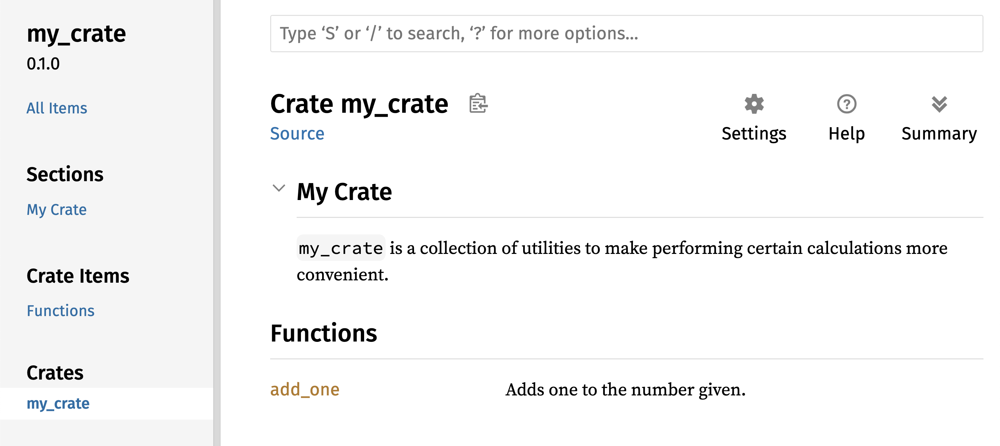

## Menerbitkan Crate ke Crates.io

Kita sudah memakai package dari [crates.io](https://crates.io/)<!-- ignore --> sebagai dependensi proyek, tetapi kamu juga bisa berbagi kode dengan orang lain dengan menerbitkan package-mu sendiri. Registry crate di [crates.io](https://crates.io/)<!-- ignore --> mendistribusikan kode sumber package-mu, jadi tempat ini terutama menjadi host bagi kode open source.

Rust dan Cargo punya fitur-fitur yang membuat package yang kamu terbitkan lebih mudah ditemukan dan dipakai orang. Selanjutnya kita akan membahas beberapa fitur itu, lalu menjelaskan cara menerbitkan sebuah package.

### Membuat Komentar Dokumentasi yang Berguna

Mendokumentasikan package dengan akurat membantu pengguna lain tahu cara dan kapan memakainya, jadi ada baiknya meluangkan waktu untuk menulis dokumentasi. Di Bab 3, kita sudah membahas cara memberi komentar pada kode Rust dengan dua garis miring, `//`. Rust juga punya jenis komentar khusus untuk dokumentasi, yang disebut _documentation comment_, yang akan menghasilkan dokumentasi HTML. HTML ini menampilkan isi komentar dokumentasi untuk item API publik yang ditujukan kepada programmer yang ingin tahu cara _memakai_ crate-mu, bukan cara crate-mu _diimplementasikan_.

Komentar dokumentasi memakai tiga garis miring, `///`, bukan dua, dan mendukung notasi Markdown untuk memformat teks. Letakkan komentar dokumentasi tepat sebelum item yang didokumentasikannya. Listing 14-1 menunjukkan komentar dokumentasi untuk fungsi `add_one` di crate bernama `my_crate`.

<Listing number="14-1" file-name="src/lib.rs" caption="Sebuah komentar dokumentasi untuk sebuah fungsi">

```rust,ignore
{{#rustdoc_include ../listings/ch14-more-about-cargo/listing-14-01/src/lib.rs}}
```

</Listing>

Di sini, kita memberi deskripsi tentang apa yang dilakukan fungsi `add_one`, memulai bagian dengan judul `Examples`, lalu menyediakan kode yang menunjukkan cara memakai fungsi `add_one`. Kita bisa menghasilkan dokumentasi HTML dari komentar dokumentasi ini dengan menjalankan `cargo doc`. Perintah ini menjalankan tool `rustdoc` yang didistribusikan bersama Rust dan menaruh dokumentasi HTML yang dihasilkan di direktori _target/doc_.

Untuk kemudahan, menjalankan `cargo doc --open` akan membangun HTML untuk dokumentasi crate-mu saat ini (serta dokumentasi semua dependensi crate-mu) dan membuka hasilnya di browser web. Buka fungsi `add_one`, dan kamu akan melihat bagaimana teks di komentar dokumentasi dirender, seperti yang ditunjukkan pada Gambar 14-1.


<span class="caption">Gambar 14-1: Dokumentasi HTML untuk fungsi `add_one`</span>

#### Bagian-Bagian yang Umum Dipakai

Kita memakai judul Markdown `# Examples` di Listing 14-1 untuk membuat bagian di HTML dengan judul "Examples." Berikut beberapa bagian lain yang biasa dipakai penulis crate dalam dokumentasinya:

- **Panics**: Skenario-skenario di mana fungsi yang didokumentasikan bisa mengalami panic. Pemanggil fungsi yang tidak ingin programnya panic harus memastikan mereka tidak memanggil fungsi ini dalam situasi-situasi tersebut.
- **Errors**: Jika fungsi mengembalikan `Result`, mendeskripsikan jenis-jenis error yang mungkin terjadi dan kondisi apa yang bisa menyebabkan error itu dikembalikan akan membantu pemanggil, supaya mereka bisa menulis kode untuk menangani berbagai jenis error dengan cara yang berbeda.
- **Safety**: Jika fungsi tersebut `unsafe` untuk dipanggil (kita membahas hal ini di Bab 20), sebaiknya ada bagian yang menjelaskan mengapa fungsi itu unsafe dan menjabarkan invariant yang diharapkan dipenuhi oleh pemanggil.

Kebanyakan komentar dokumentasi tidak memerlukan semua bagian ini, tetapi daftar ini berguna sebagai pengingat akan aspek-aspek kode yang ingin diketahui pengguna.

<a id="documentation-comments-as-tests"></a>
#### Komentar Dokumentasi sebagai Test

Menambahkan blok kode contoh di komentar dokumentasi membantu menunjukkan cara memakai library-mu dan punya keuntungan tambahan: menjalankan `cargo test` akan menjalankan contoh-contoh kode di dokumentasimu sebagai test! Tidak ada yang lebih baik daripada dokumentasi dengan contoh. Tetapi tidak ada yang lebih buruk daripada contoh yang tidak berfungsi karena kode sudah berubah sejak dokumentasi ditulis. Jika kita menjalankan `cargo test` dengan dokumentasi untuk fungsi `add_one` dari Listing 14-1, kita akan melihat bagian di hasil test yang tampak seperti ini:

<!-- manual-regeneration
cd listings/ch14-more-about-cargo/listing-14-01/
cargo test
copy just the doc-tests section below
-->

```text
   Doc-tests my_crate

running 1 test
test src/lib.rs - add_one (line 5) ... ok

test result: ok. 1 passed; 0 failed; 0 ignored; 0 measured; 0 filtered out; finished in 0.27s
```

Sekarang, jika kita mengubah fungsi atau contohnya sehingga `assert_eq!` di contoh mengalami panic, lalu menjalankan `cargo test` lagi, kita akan melihat bahwa doc test mendeteksi contoh dan kode sudah tidak sinkron satu sama lain!

<!-- Old headings. Do not remove or links may break. -->

<a id="commenting-contained-items"></a>

#### Komentar pada Item yang Mengandungnya

Gaya komentar doc `//!` menambahkan dokumentasi pada item yang *mengandung* komentar itu, bukan pada item yang *mengikuti* komentar. Kita biasanya memakai komentar doc ini di dalam file root crate (_src/lib.rs_ sesuai konvensi) atau di dalam sebuah module untuk mendokumentasikan crate atau module secara keseluruhan.

Misalnya, untuk menambahkan dokumentasi yang menjelaskan tujuan crate `my_crate` yang berisi fungsi `add_one`, kita menambahkan komentar dokumentasi yang diawali `//!` di awal file _src/lib.rs_, seperti yang ditunjukkan pada Listing 14-2.

<Listing number="14-2" file-name="src/lib.rs" caption="Dokumentasi untuk crate `my_crate` secara keseluruhan">

```rust,ignore
{{#rustdoc_include ../listings/ch14-more-about-cargo/listing-14-02/src/lib.rs:here}}
```

</Listing>

Perhatikan bahwa tidak ada kode setelah baris terakhir yang diawali `//!`. Karena kita mengawali komentar dengan `//!`, bukan `///`, kita mendokumentasikan item yang mengandung komentar ini, bukan item yang mengikutinya. Dalam hal ini, item itu adalah file _src/lib.rs_, yaitu root crate. Komentar-komentar ini mendeskripsikan seluruh crate.

Saat kita menjalankan `cargo doc --open`, komentar-komentar ini akan tampil di halaman depan dokumentasi `my_crate`, di atas daftar item publik di crate, seperti yang ditunjukkan pada Gambar 14-2.

Komentar dokumentasi di dalam item sangat berguna untuk mendeskripsikan crate dan module. Pakailah untuk menjelaskan tujuan keseluruhan dari wadah itu, agar pengguna paham bagaimana crate disusun.



<span class="caption">Gambar 14-2: Dokumentasi `my_crate` yang dirender, termasuk komentar yang mendeskripsikan crate secara keseluruhan</span>

<!-- Old headings. Do not remove or links may break. -->

<a id="exporting-a-convenient-public-api-with-pub-use"></a>

<a id="exporting-a-convenient-public-api"></a>
### Mengekspor API Publik yang Nyaman Dipakai

Struktur API publik-mu menjadi pertimbangan utama saat menerbitkan crate. Orang-orang yang memakai crate-mu tidak sepaham kamu soal strukturnya, dan mereka bisa kesulitan menemukan bagian yang ingin dipakai jika crate-mu punya hierarki module yang besar.

Di Bab 7, kita sudah membahas cara membuat item menjadi publik dengan keyword `pub`, dan cara membawa item ke dalam scope dengan keyword `use`. Akan tetapi, struktur yang masuk akal bagi kamu saat mengembangkan crate belum tentu nyaman bagi pengguna. Kamu mungkin ingin menyusun struct-struct-mu dalam hierarki beberapa level, tetapi orang yang ingin memakai tipe yang kamu definisikan jauh di dalam hierarki bisa kesulitan mengetahui bahwa tipe itu ada. Mereka juga bisa merasa kesulitan harus menulis `use
my_crate::some_module::another_module::UsefulType;` alih-alih `use
my_crate::UsefulType;`.

Kabar baiknya, jika struktur itu _tidak_ nyaman dipakai orang lain dari library lain, kamu tidak perlu menyusun ulang struktur internalmu. Sebagai gantinya, kamu bisa mengekspor ulang item dengan `pub use` untuk membuat struktur publik yang berbeda dari struktur privatmu. *Mengekspor ulang* mengambil item publik di satu lokasi dan membuatnya publik di lokasi lain, seolah-olah item itu didefinisikan di lokasi tersebut.

Misalnya, kita membuat library bernama `art` untuk memodelkan konsep-konsep seni. Di dalam library ini ada dua module: module `kinds` yang berisi dua enum bernama `PrimaryColor` dan `SecondaryColor`, dan module `utils` yang berisi fungsi bernama `mix`, seperti yang ditunjukkan pada Listing 14-3.

<Listing number="14-3" file-name="src/lib.rs" caption="Library `art` dengan item-item yang disusun dalam module `kinds` dan `utils`">

```rust,noplayground,test_harness
{{#rustdoc_include ../listings/ch14-more-about-cargo/listing-14-03/src/lib.rs:here}}
```

</Listing>

Gambar 14-3 menunjukkan tampilan halaman depan dokumentasi crate ini yang dihasilkan oleh `cargo doc`.


<span class="caption">Gambar 14-3: Halaman depan dokumentasi `art` yang mencantumkan module `kinds` dan `utils`</span>

Perhatikan bahwa tipe `PrimaryColor` dan `SecondaryColor` tidak tercantum di halaman depan, demikian juga fungsi `mix`. Kita harus mengklik `kinds` dan `utils` untuk melihatnya.

Crate lain yang bergantung pada library ini memerlukan statement `use` yang membawa item dari `art` ke dalam scope, dengan menyebutkan struktur module yang saat ini didefinisikan. Listing 14-4 menunjukkan contoh crate yang memakai item `PrimaryColor` dan `mix` dari crate `art`.

<Listing number="14-4" file-name="src/main.rs" caption="Sebuah crate yang memakai item-item crate `art` dengan struktur internalnya diekspor">

```rust,ignore
{{#rustdoc_include ../listings/ch14-more-about-cargo/listing-14-04/src/main.rs}}
```

</Listing>

Penulis kode di Listing 14-4, yang memakai crate `art`, harus mencari tahu bahwa `PrimaryColor` ada di module `kinds` dan `mix` ada di module `utils`. Struktur module crate `art` lebih relevan bagi pengembang yang mengerjakan crate `art` daripada bagi orang yang memakainya. Struktur internal itu tidak memberi informasi berguna bagi orang yang ingin memahami cara memakai crate `art`, malah menimbulkan kebingungan karena pengembang yang memakainya harus mencari tahu ke mana harus melihat, dan harus menyebut nama module di statement `use`.

Untuk menghapus struktur internal dari API publik, kita bisa mengubah kode crate `art` di Listing 14-3 dengan menambahkan statement `pub use` untuk mengekspor ulang item-item di level teratas, seperti yang ditunjukkan pada Listing 14-5.

<Listing number="14-5" file-name="src/lib.rs" caption="Menambahkan statement `pub use` untuk mengekspor ulang item">

```rust,ignore
{{#rustdoc_include ../listings/ch14-more-about-cargo/listing-14-05/src/lib.rs:here}}
```

</Listing>

Dokumentasi API yang dihasilkan `cargo doc` untuk crate ini sekarang akan mencantumkan dan menautkan hasil ekspor ulang di halaman depan, seperti yang ditunjukkan pada Gambar 14-4, sehingga tipe `PrimaryColor` dan `SecondaryColor` serta fungsi `mix` lebih mudah ditemukan.


<span class="caption">Gambar 14-4: Halaman depan dokumentasi `art` yang mencantumkan hasil ekspor ulang</span>

Pengguna crate `art` tetap bisa melihat dan memakai struktur internal dari Listing 14-3 seperti yang ditunjukkan di Listing 14-4, atau mereka bisa memakai struktur yang lebih nyaman di Listing 14-5, seperti yang ditunjukkan pada Listing 14-6.

<Listing number="14-6" file-name="src/main.rs" caption="Sebuah program yang memakai item-item yang diekspor ulang dari crate `art`">

```rust,ignore
{{#rustdoc_include ../listings/ch14-more-about-cargo/listing-14-06/src/main.rs:here}}
```

</Listing>

Dalam kasus dengan banyak module bertingkat, mengekspor ulang tipe-tipe di level teratas dengan `pub use` bisa membuat perbedaan besar bagi pengalaman orang-orang yang memakai crate. Penggunaan umum lain dari `pub use` adalah mengekspor ulang definisi dari sebuah dependensi di crate saat ini, supaya definisi crate itu menjadi bagian dari API publik crate-mu.

Membuat struktur API publik yang berguna lebih mirip seni daripada sains, dan kamu bisa mengulang-ulang untuk menemukan API yang paling cocok bagi pengguna. Memilih `pub use` memberi kamu fleksibilitas dalam menyusun crate secara internal dan memisahkan struktur internal itu dari apa yang kamu tunjukkan kepada pengguna. Lihatlah kode beberapa crate yang sudah kamu pasang untuk melihat apakah struktur internal mereka berbeda dari API publiknya.

### Menyiapkan Akun Crates.io

Sebelum bisa menerbitkan crate apa pun, kamu perlu membuat akun di [crates.io](https://crates.io/)<!-- ignore --> dan mendapatkan token API. Untuk melakukannya, buka halaman utama di [crates.io](https://crates.io/)<!-- ignore --> dan masuk lewat akun GitHub. (Saat ini akun GitHub memang diwajibkan, tetapi situs ini mungkin akan mendukung cara lain untuk membuat akun di masa depan.) Setelah masuk, buka pengaturan akunmu di [https://crates.io/me/](https://crates.io/me/)<!-- ignore --> dan ambil API key-mu. Lalu, jalankan perintah `cargo login` dan tempel API key-mu saat diminta, seperti ini:

```console
$ cargo login
abcdefghijklmnopqrstuvwxyz012345
```

Perintah ini memberi tahu Cargo tentang token API-mu dan menyimpannya secara lokal di _~/.cargo/credentials.toml_. Perlu diingat bahwa token ini bersifat rahasia: jangan bagikan kepada siapa pun. Jika kamu membagikannya kepada siapa pun dengan alasan apa pun, kamu harus mencabutnya dan membuat token baru di [crates.io](https://crates.io/)<!-- ignore
-->.

### Menambahkan Metadata ke Crate Baru

Misalkan kamu punya crate yang ingin diterbitkan. Sebelum menerbitkannya, kamu perlu menambahkan beberapa metadata di bagian `[package]` dari file _Cargo.toml_ crate itu.

Crate-mu memerlukan nama yang unik. Saat mengerjakan crate secara lokal, kamu bisa memberi nama apa pun yang kamu mau. Namun, nama crate di [crates.io](https://crates.io/)<!-- ignore --> dialokasikan berdasarkan siapa cepat dia dapat. Begitu sebuah nama crate diambil, tidak ada orang lain yang bisa menerbitkan crate dengan nama itu. Sebelum mencoba menerbitkan crate, carilah nama yang ingin kamu pakai. Jika nama itu sudah dipakai, kamu harus mencari nama lain dan mengubah field `name` di file _Cargo.toml_ pada bagian `[package]` agar memakai nama baru untuk penerbitan, seperti ini:

<span class="filename">Filename: Cargo.toml</span>

```toml
[package]
name = "guessing_game"
```

Bahkan jika kamu sudah memilih nama yang unik, saat menjalankan `cargo publish` untuk menerbitkan crate pada tahap ini, kamu akan mendapat peringatan lalu sebuah error:

<!-- manual-regeneration
Create a new package with an unregistered name, making no further modifications
  to the generated package, so it is missing the description and license fields.
cargo publish
copy just the relevant lines below
-->

```console
$ cargo publish
    Updating crates.io index
warning: manifest has no description, license, license-file, documentation, homepage or repository.
See https://doc.rust-lang.org/cargo/reference/manifest.html#package-metadata for more info.
--snip--
error: failed to publish to registry at https://crates.io

Caused by:
  the remote server responded with an error (status 400 Bad Request): missing or empty metadata fields: description, license. Please see https://doc.rust-lang.org/cargo/reference/manifest.html for more information on configuring these fields
```

Ini menghasilkan error karena kamu kehilangan beberapa informasi penting: deskripsi dan lisensi wajib diisi agar orang tahu apa yang dilakukan crate-mu dan dengan syarat apa mereka boleh memakainya. Di _Cargo.toml_, tambahkan deskripsi yang cukup satu atau dua kalimat, karena deskripsi ini akan muncul bersama crate-mu di hasil pencarian. Untuk field `license`, kamu perlu memberikan _nilai identifier lisensi_. [Software Package Data Exchange (SPDX) milik Linux Foundation][spdx] mencantumkan identifier yang bisa kamu pakai untuk nilai ini. Misalnya, untuk menyatakan bahwa kamu melisensikan crate-mu dengan MIT License, tambahkan identifier `MIT`:

<span class="filename">Filename: Cargo.toml</span>

```toml
[package]
name = "guessing_game"
license = "MIT"
```

Jika kamu ingin memakai lisensi yang tidak tercantum di SPDX, kamu perlu meletakkan teks lisensi itu di sebuah file, menyertakan file tersebut dalam proyekmu, lalu memakai `license-file` untuk menentukan nama file itu, alih-alih memakai key `license`.

Panduan tentang lisensi mana yang tepat untuk proyekmu berada di luar cakupan buku ini. Banyak orang di komunitas Rust melisensikan proyek mereka dengan cara yang sama seperti Rust, yaitu memakai lisensi ganda `MIT OR Apache-2.0`. Praktik ini menunjukkan bahwa kamu juga bisa menentukan beberapa identifier lisensi yang dipisahkan dengan `OR` untuk memberi proyekmu beberapa lisensi.

Dengan nama yang unik, versi, deskripsi, dan lisensi yang sudah ditambahkan, file _Cargo.toml_ untuk proyek yang siap diterbitkan mungkin tampak seperti ini:

<span class="filename">Filename: Cargo.toml</span>

```toml
[package]
name = "guessing_game"
version = "0.1.0"
edition = "2024"
description = "A fun game where you guess what number the computer has chosen."
license = "MIT OR Apache-2.0"

[dependencies]
```

[Dokumentasi Cargo](https://doc.rust-lang.org/cargo/) menjelaskan metadata lain yang bisa kamu tentukan supaya orang lain lebih mudah menemukan dan memakai crate-mu.

### Menerbitkan ke Crates.io

Sekarang setelah kamu membuat akun, menyimpan token API, memilih nama untuk crate-mu, dan menentukan metadata yang diperlukan, kamu siap menerbitkan! Menerbitkan crate berarti mengunggah versi tertentu ke [crates.io](https://crates.io/)<!-- ignore --> agar bisa dipakai orang lain.

Hati-hati, karena penerbitan bersifat _permanen_. Versi yang sudah diterbitkan tidak bisa ditimpa, dan kode tidak bisa dihapus kecuali dalam kondisi tertentu. Salah satu tujuan utama Crates.io adalah menjadi arsip kode permanen, supaya build semua proyek yang bergantung pada crate dari [crates.io](https://crates.io/)<!-- ignore --> tetap berfungsi. Mengizinkan penghapusan versi akan membuat tujuan itu mustahil dicapai. Namun, tidak ada batas jumlah versi crate yang bisa kamu terbitkan.

Jalankan lagi perintah `cargo publish`. Sekarang seharusnya berhasil:

<!-- manual-regeneration
go to some valid crate, publish a new version
cargo publish
copy just the relevant lines below
-->

```console
$ cargo publish
    Updating crates.io index
   Packaging guessing_game v0.1.0 (file:///projects/guessing_game)
    Packaged 6 files, 1.2KiB (895.0B compressed)
   Verifying guessing_game v0.1.0 (file:///projects/guessing_game)
   Compiling guessing_game v0.1.0
(file:///projects/guessing_game/target/package/guessing_game-0.1.0)
    Finished `dev` profile [unoptimized + debuginfo] target(s) in 0.19s
   Uploading guessing_game v0.1.0 (file:///projects/guessing_game)
    Uploaded guessing_game v0.1.0 to registry `crates-io`
note: waiting for `guessing_game v0.1.0` to be available at registry
`crates-io`.
You may press ctrl-c to skip waiting; the crate should be available shortly.
   Published guessing_game v0.1.0 at registry `crates-io`
```

Selamat! Sekarang kamu sudah berbagi kode dengan komunitas Rust, dan siapa pun bisa dengan mudah menambahkan crate-mu sebagai dependensi proyek mereka.

### Menerbitkan Versi Baru dari Crate yang Sudah Ada

Saat kamu sudah membuat perubahan pada crate dan siap merilis versi baru, kamu mengubah nilai `version` yang ditentukan di file _Cargo.toml_ lalu menerbitkannya lagi. Pakai [aturan Semantic Versioning][semver] untuk memutuskan nomor versi berikutnya yang tepat, bergantung pada jenis perubahan yang kamu buat. Lalu, jalankan `cargo publish` untuk mengunggah versi baru itu.

<!-- Old headings. Do not remove or links may break. -->

<a id="removing-versions-from-cratesio-with-cargo-yank"></a>
<a id="deprecating-versions-from-cratesio-with-cargo-yank"></a>

### Menghentikan Penggunaan Versi dari Crates.io

Meski kamu tidak bisa menghapus versi-versi sebelumnya dari sebuah crate, kamu bisa mencegah proyek-proyek baru menambahkannya sebagai dependensi baru. Ini berguna ketika suatu versi crate rusak karena satu alasan atau lain. Dalam situasi seperti itu, Cargo mendukung yank terhadap versi crate.

_Yank_ terhadap sebuah versi mencegah proyek baru bergantung pada versi itu, sambil membiarkan semua proyek yang sudah bergantung padanya tetap berjalan. Pada dasarnya, yank berarti semua proyek yang punya _Cargo.lock_ tidak akan rusak, dan setiap _Cargo.lock_ yang dibuat di masa depan tidak akan memakai versi yang di-yank.

Untuk men-yank sebuah versi crate, di direktori crate yang sudah kamu terbitkan sebelumnya, jalankan `cargo yank` dan tentukan versi mana yang ingin di-yank. Misalnya, jika kita sudah menerbitkan crate bernama `guessing_game` versi 1.0.1 dan ingin men-yank-nya, maka kita menjalankan perintah berikut di direktori proyek `guessing_game`:

<!-- manual-regeneration:
cargo yank carol-test --version 2.1.0
cargo yank carol-test --version 2.1.0 --undo
-->

```console
$ cargo yank --vers 1.0.1
    Updating crates.io index
        Yank guessing_game@1.0.1
```

Dengan menambahkan `--undo` pada perintah, kamu juga bisa membatalkan yank dan mengizinkan proyek mulai bergantung lagi pada sebuah versi:

```console
$ cargo yank --vers 1.0.1 --undo
    Updating crates.io index
      Unyank guessing_game@1.0.1
```

Sebuah yank _tidak_ menghapus kode apa pun. Misalnya, yank tidak bisa menghapus rahasia yang tidak sengaja terunggah. Jika itu terjadi, kamu harus segera mereset rahasia-rahasia itu.

[spdx]: https://spdx.org/licenses/
[semver]: https://semver.org/
