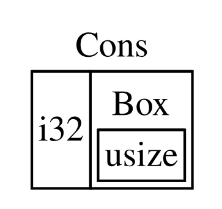

## Menggunakan `Box<T>` untuk Menunjuk ke Data di Heap

Smart pointer yang paling sederhana adalah box, yang tipenya ditulis `Box<T>`. _Box_ memungkinkan kamu menyimpan data di heap alih-alih di stack. Yang tersisa di stack hanyalah pointer ke data di heap itu. Lihat Bab 4 untuk mengulas kembali perbedaan antara stack dan heap.

Box tidak punya overhead performa, selain menyimpan datanya di heap alih-alih di stack. Tetapi box juga tidak punya banyak kemampuan ekstra. Kamu akan paling sering menggunakannya dalam situasi-situasi ini:

- Saat kamu punya tipe yang ukurannya tidak bisa diketahui saat mengompilasi, dan kamu ingin memakai nilai dari tipe itu dalam konteks yang membutuhkan ukuran pasti
- Saat kamu punya sekumpulan data besar, dan kamu ingin memindahkan ownership tetapi memastikan data itu tidak akan disalin saat melakukannya
- Saat kamu ingin memiliki sebuah nilai, dan yang kamu pedulikan hanyalah bahwa nilainya bertipe yang mengimplementasikan trait tertentu, bukan tipe spesifik tertentu

Kita akan mendemonstrasikan situasi pertama dalam ["Mengaktifkan Tipe Rekursif dengan Box"](#enabling-recursive-types-with-boxes)<!-- ignore -->. Pada kasus kedua, memindahkan ownership dari sekumpulan data besar bisa memakan waktu lama karena datanya disalin-salin di stack. Untuk meningkatkan performa dalam situasi ini, kita bisa menyimpan data besar itu di heap di dalam sebuah box. Dengan begitu, hanya sedikit data pointer yang disalin-salin di stack, sementara data yang ditunjuknya tetap berada di satu tempat di heap. Kasus ketiga dikenal sebagai _trait object_, dan ["Menggunakan Trait Object untuk Abstraksi atas Perilaku Bersama"][trait-objects]<!-- ignore --> di Bab 18 dikhususkan untuk topik itu. Jadi, apa yang kamu pelajari di sini akan kamu pakai lagi di bagian itu!

<!-- Old headings. Do not remove or links may break. -->

<a id="using-boxt-to-store-data-on-the-heap"></a>

### Menyimpan Data di Heap

Sebelum membahas kasus penggunaan penyimpanan di heap untuk `Box<T>`, kita akan membahas sintaksnya dan cara berinteraksi dengan nilai yang disimpan di dalam `Box<T>`.

Listing 15-1 menunjukkan cara memakai box untuk menyimpan nilai `i32` di heap.

<Listing number="15-1" file-name="src/main.rs" caption="Menyimpan nilai `i32` di heap menggunakan box">

```rust
{{#rustdoc_include ../listings/ch15-smart-pointers/listing-15-01/src/main.rs}}
```

</Listing>

Kita mendefinisikan variabel `b` dengan nilai berupa `Box` yang menunjuk ke nilai `5`, yang dialokasikan di heap. Program ini akan mencetak `b = 5`; dalam kasus ini, kita bisa mengakses data di dalam box dengan cara yang serupa seperti ketika data itu berada di stack. Sama seperti nilai yang dimiliki (owned), ketika box keluar dari scope—seperti `b` di akhir `main`—memorinya akan dibebaskan. Pembebasan itu terjadi baik pada box (yang disimpan di stack) maupun pada data yang ditunjuknya (yang disimpan di heap).

Menaruh satu nilai di heap tidak terlalu berguna, jadi kamu tidak akan sering memakai box dengan cara seperti ini. Menyimpan nilai seperti satu `i32` di stack—tempat nilai itu disimpan secara default—lebih tepat dalam sebagian besar situasi. Mari kita lihat sebuah kasus di mana box memungkinkan kita mendefinisikan tipe yang tidak boleh kita definisikan jika kita tidak punya box.

<a id="enabling-recursive-types-with-boxes"></a>
### Mengaktifkan Tipe Rekursif dengan Box

Sebuah nilai dari _tipe rekursif_ bisa memiliki nilai lain dengan tipe yang sama sebagai bagian dari dirinya. Tipe rekursif menimbulkan masalah karena Rust perlu tahu saat mengompilasi berapa banyak ruang yang dibutuhkan sebuah tipe. Akan tetapi, nilai-nilai tipe rekursif bisa saling bersarang secara teori hingga tak terhingga, sehingga Rust tidak bisa tahu berapa banyak ruang yang dibutuhkan nilainya. Karena box punya ukuran yang diketahui, kita bisa mengaktifkan tipe rekursif dengan menyisipkan sebuah box dalam definisi tipe rekursif itu.

Sebagai contoh tipe rekursif, mari kita bahas cons list. Ini adalah tipe data yang umum ditemukan di bahasa pemrograman fungsional. Tipe cons list yang akan kita definisikan cukup sederhana, kecuali bagian rekursinya; karena itu, konsep-konsep dalam contoh yang akan kita kerjakan akan berguna kapan pun kamu berhadapan dengan situasi yang lebih kompleks yang melibatkan tipe rekursif.

<!-- Old headings. Do not remove or links may break. -->

<a id="more-information-about-the-cons-list"></a>

#### Memahami Cons List

Sebuah _cons list_ adalah struktur data yang berasal dari bahasa pemrograman Lisp dan turunannya, terdiri dari pasangan-pasangan bersarang, dan merupakan versi Lisp dari linked list. Namanya berasal dari fungsi `cons` (singkatan dari _construct function_) dalam Lisp yang membentuk pasangan baru dari dua argumennya. Dengan memanggil `cons` pada sebuah pasangan yang terdiri dari sebuah nilai dan pasangan lainnya, kita bisa membentuk cons list yang tersusun dari pasangan-pasangan rekursif.

Misalnya, berikut ini representasi pseudocode dari sebuah cons list yang berisi daftar `1, 2, 3`, dengan setiap pasangan di dalam tanda kurung:

```text
(1, (2, (3, Nil)))
```

Setiap item dalam cons list berisi dua elemen: nilai dari item saat ini dan nilai dari item berikutnya. Item terakhir dalam daftar hanya berisi sebuah nilai bernama `Nil` tanpa item berikutnya. Sebuah cons list dibentuk dengan memanggil fungsi `cons` secara rekursif. Nama baku untuk menandai kasus dasar dari rekursi ini adalah `Nil`. Perhatikan bahwa ini berbeda dengan konsep "null" atau "nil" yang dibahas di Bab 6, yang merupakan nilai yang tidak valid atau tidak ada.

Cons list bukanlah struktur data yang umum dipakai di Rust. Sebagian besar waktu ketika kamu punya daftar item di Rust, `Vec<T>` adalah pilihan yang lebih baik. Tipe data rekursif lain yang lebih kompleks _memang_ berguna dalam berbagai situasi, tetapi dengan mulai dari cons list di bab ini, kita bisa menjelajahi bagaimana box memungkinkan kita mendefinisikan tipe data rekursif tanpa banyak gangguan.

Listing 15-2 berisi definisi enum untuk sebuah cons list. Perhatikan bahwa kode ini belum bisa dikompilasi, karena tipe `List` tidak punya ukuran yang diketahui—seperti yang akan kita tunjukkan.

<Listing number="15-2" file-name="src/main.rs" caption="Percobaan pertama mendefinisikan enum untuk merepresentasikan struktur data cons list dari nilai-nilai `i32`">

```rust,ignore,does_not_compile
{{#rustdoc_include ../listings/ch15-smart-pointers/listing-15-02/src/main.rs:here}}
```

</Listing>

> Catatan: Kita mengimplementasikan cons list yang hanya menyimpan nilai `i32` demi kebutuhan contoh ini. Kita bisa saja mengimplementasikannya dengan generic, seperti yang kita bahas di Bab 10, untuk mendefinisikan tipe cons list yang bisa menyimpan nilai dari tipe apa pun.

Memakai tipe `List` untuk menyimpan daftar `1, 2, 3` akan terlihat seperti kode di Listing 15-3.

<Listing number="15-3" file-name="src/main.rs" caption="Memakai enum `List` untuk menyimpan daftar `1, 2, 3`">

```rust,ignore,does_not_compile
{{#rustdoc_include ../listings/ch15-smart-pointers/listing-15-03/src/main.rs:here}}
```

</Listing>

Nilai `Cons` pertama menyimpan `1` dan nilai `List` lainnya. Nilai `List` ini adalah nilai `Cons` lain yang menyimpan `2` dan nilai `List` lainnya. Nilai `List` itu adalah satu nilai `Cons` lagi yang menyimpan `3` dan sebuah nilai `List`, yang akhirnya adalah `Nil`—varian non-rekursif yang menandai akhir dari daftar.

Jika kita mencoba mengompilasi kode di Listing 15-3, kita mendapat error seperti yang ditunjukkan di Listing 15-4.

<Listing number="15-4" caption="Error yang kita dapatkan saat mencoba mendefinisikan enum rekursif">

```console
{{#include ../listings/ch15-smart-pointers/listing-15-03/output.txt}}
```

</Listing>

Error itu menunjukkan bahwa tipe ini "berukuran tak terhingga". Alasannya adalah kita mendefinisikan `List` dengan sebuah varian yang bersifat rekursif: varian itu menyimpan nilai lain dari dirinya secara langsung. Akibatnya, Rust tidak bisa mengetahui berapa banyak ruang yang dibutuhkan untuk menyimpan nilai `List`. Mari kita uraikan mengapa kita mendapat error ini. Pertama, kita akan melihat bagaimana Rust memutuskan berapa banyak ruang yang dibutuhkan untuk menyimpan nilai dari tipe non-rekursif.

#### Menghitung Ukuran Tipe Non-Rekursif

Ingat enum `Message` yang kita definisikan di Listing 6-2 ketika membahas definisi enum di Bab 6:

```rust
{{#rustdoc_include ../listings/ch06-enums-and-pattern-matching/listing-06-02/src/main.rs:here}}
```

Untuk menentukan berapa banyak ruang yang harus dialokasikan bagi nilai `Message`, Rust memeriksa setiap varian untuk melihat varian mana yang membutuhkan ruang paling besar. Rust melihat bahwa `Message::Quit` tidak membutuhkan ruang sama sekali, `Message::Move` membutuhkan ruang yang cukup untuk menyimpan dua nilai `i32`, dan seterusnya. Karena hanya satu varian yang akan dipakai, ruang paling besar yang dibutuhkan nilai `Message` adalah ruang yang dibutuhkan untuk menyimpan varian terbesarnya.

Bandingkan ini dengan apa yang terjadi ketika Rust mencoba menentukan berapa banyak ruang yang dibutuhkan tipe rekursif seperti enum `List` di Listing 15-2. Compiler mulai dengan melihat varian `Cons`, yang menyimpan nilai bertipe `i32` dan nilai bertipe `List`. Jadi, `Cons` membutuhkan ruang sebesar ukuran sebuah `i32` ditambah ukuran sebuah `List`. Untuk mengetahui berapa banyak memori yang dibutuhkan tipe `List`, compiler melihat varian-variannya, mulai dari varian `Cons`. Varian `Cons` menyimpan nilai bertipe `i32` dan nilai bertipe `List`, dan proses ini berlanjut tanpa henti, seperti yang ditunjukkan pada Gambar 15-1.


<span class="caption">Gambar 15-1: Sebuah `List` tak terhingga yang terdiri dari
varian-varian `Cons` tak terhingga</span>

<!-- Old headings. Do not remove or links may break. -->

<a id="using-boxt-to-get-a-recursive-type-with-a-known-size"></a>

#### Mendapatkan Tipe Rekursif dengan Ukuran yang Diketahui

Karena Rust tidak bisa mengetahui berapa banyak ruang yang harus dialokasikan untuk tipe yang didefinisikan secara rekursif, compiler memberikan error dengan saran yang membantu ini:

<!-- manual-regeneration
after doing automatic regeneration, look at listings/ch15-smart-pointers/listing-15-03/output.txt and copy the relevant line
-->

```text
help: insert some indirection (e.g., a `Box`, `Rc`, or `&`) to break the cycle
  |
2 |     Cons(i32, Box<List>),
  |               ++++    +
```

Dalam saran ini, _indireksi_ berarti bahwa alih-alih menyimpan nilai secara langsung, kita harus mengubah struktur data untuk menyimpan nilai itu secara tidak langsung, yaitu dengan menyimpan pointer ke nilai tersebut.

Karena `Box<T>` adalah pointer, Rust selalu tahu berapa banyak ruang yang dibutuhkan `Box<T>`: ukuran sebuah pointer tidak berubah berdasarkan jumlah data yang ditunjuknya. Ini berarti kita bisa meletakkan `Box<T>` di dalam varian `Cons`, alih-alih nilai `List` lain secara langsung. `Box<T>` itu akan menunjuk ke nilai `List` berikutnya yang berada di heap, bukan di dalam varian `Cons`. Secara konseptual, kita tetap punya sebuah daftar, yang dibuat dari daftar-daftar yang menyimpan daftar lain, tetapi implementasi ini sekarang lebih seperti meletakkan item-item bersebelahan, bukan di dalam satu sama lain.

Kita bisa mengubah definisi enum `List` di Listing 15-2 dan pemakaian `List` di Listing 15-3 menjadi kode di Listing 15-5, yang akan bisa dikompilasi.

<Listing number="15-5" file-name="src/main.rs" caption="Definisi `List` yang memakai `Box<T>` agar punya ukuran yang diketahui">

```rust
{{#rustdoc_include ../listings/ch15-smart-pointers/listing-15-05/src/main.rs}}
```

</Listing>

Varian `Cons` membutuhkan ukuran sebuah `i32` ditambah ruang untuk menyimpan data pointer box itu. Varian `Nil` tidak menyimpan nilai apa pun, jadi ia membutuhkan lebih sedikit ruang di stack daripada varian `Cons`. Sekarang kita tahu bahwa nilai `List` apa pun akan memakan ukuran sebuah `i32` ditambah ukuran data pointer sebuah box. Dengan memakai box, kita telah memutus rantai rekursif tak terhingga itu, sehingga compiler bisa mengetahui ukuran yang dibutuhkan untuk menyimpan nilai `List`. Gambar 15-2 menunjukkan tampilan varian `Cons` sekarang.



<span class="caption">Gambar 15-2: Sebuah `List` yang tidak berukuran tak terhingga,
karena `Cons` menyimpan sebuah `Box`</span>

Box hanya menyediakan indireksi dan alokasi di heap; box tidak punya kemampuan khusus lain seperti yang akan kita lihat pada tipe-tipe smart pointer lainnya. Box juga tidak punya overhead performa yang ditimbulkan kemampuan-kemampuan khusus itu, jadi box bisa berguna dalam kasus seperti cons list, di mana indireksi adalah satu-satunya fitur yang kita butuhkan. Kita akan melihat lebih banyak kasus penggunaan box di Bab 18.

Tipe `Box<T>` adalah smart pointer karena ia mengimplementasikan trait `Deref`, yang memungkinkan nilai `Box<T>` diperlakukan seperti reference. Ketika nilai `Box<T>` keluar dari scope, data di heap yang ditunjuk box itu juga dibersihkan berkat implementasi trait `Drop`. Kedua trait ini akan semakin penting bagi fungsionalitas yang diberikan tipe-tipe smart pointer lain yang akan kita bahas di sisa bab ini. Mari kita bahas kedua trait ini lebih lanjut.

[trait-objects]: ch18-02-trait-objects.html#using-trait-objects-to-abstract-over-shared-behavior
