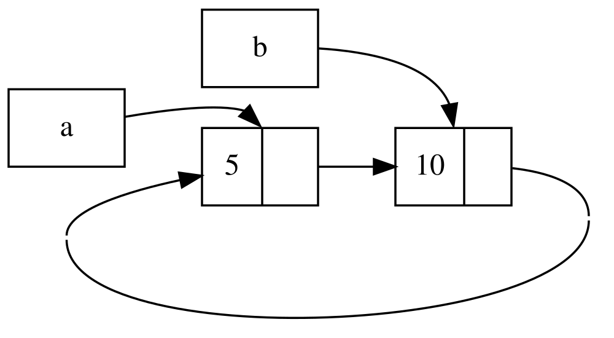

## Siklus Reference Dapat Membocorkan Memori

Jaminan keamanan memori Rust membuatnya sulit, tetapi bukan mustahil, untuk secara tidak sengaja menciptakan memori yang tidak pernah dibersihkan (dikenal sebagai _memory leak_). Mencegah kebocoran memori sepenuhnya bukanlah salah satu jaminan Rust, yang berarti kebocoran memori tetap aman dalam Rust. Kita bisa melihat bahwa Rust mengizinkan kebocoran memori dengan menggunakan `Rc<T>` dan `RefCell<T>`: Memungkinkan untuk membuat reference di mana item-item saling merujuk dalam sebuah siklus. Ini menciptakan kebocoran memori karena jumlah reference dari setiap item dalam siklus tidak akan pernah mencapai 0, dan nilai-nilainya tidak akan pernah di-drop.

### Membuat Siklus Reference

Mari kita lihat bagaimana siklus reference bisa terjadi dan cara mencegahnya, mulai dari definisi enum `List` dan method `tail` di Listing 15-25.

<Listing number="15-25" file-name="src/main.rs" caption="Definisi list cons yang menyimpan `RefCell<T>` sehingga kita bisa mengubah apa yang dirujuk oleh varian `Cons`">

```rust
{{#rustdoc_include ../listings/ch15-smart-pointers/listing-15-25/src/main.rs:here}}
```

</Listing>

Kita menggunakan variasi lain dari definisi `List` di Listing 15-5. Elemen kedua dalam varian `Cons` sekarang adalah `RefCell<Rc<List>>`, yang berarti alih-alih bisa mengubah nilai `i32` seperti yang kita lakukan di Listing 15-24, kita ingin mengubah nilai `List` yang dirujuk oleh varian `Cons`. Kita juga menambahkan method `tail` agar lebih mudah mengakses item kedua jika kita memiliki varian `Cons`.

Di Listing 15-26, kita menambahkan fungsi `main` yang menggunakan definisi di Listing 15-25. Kode ini membuat sebuah list di `a` dan sebuah list di `b` yang menunjuk ke list di `a`. Lalu, kode itu mengubah list di `a` agar menunjuk ke `b`, sehingga terciptalah siklus reference. Ada statement `println!` di sepanjang proses untuk menunjukkan berapa jumlah reference di berbagai titik.

<Listing number="15-26" file-name="src/main.rs" caption="Membuat siklus reference dari dua nilai `List` yang saling menunjuk">

```rust
{{#rustdoc_include ../listings/ch15-smart-pointers/listing-15-26/src/main.rs:here}}
```

</Listing>

Kita membuat sebuah instance `Rc<List>` yang menyimpan nilai `List` dalam variabel `a` dengan list awal `5, Nil`. Lalu kita membuat instance `Rc<List>` lain yang menyimpan nilai `List` dalam variabel `b` yang berisi nilai `10` dan menunjuk ke list di `a`.

Kita mengubah `a` agar menunjuk ke `b`, bukan ke `Nil`, sehingga tercipta siklus. Kita melakukan itu dengan menggunakan method `tail` untuk mendapatkan reference ke `RefCell<Rc<List>>` di `a`, yang kita simpan dalam variabel `link`. Lalu, kita memakai method `borrow_mut` pada `RefCell<Rc<List>>` untuk mengubah nilai di dalamnya dari `Rc<List>` yang menyimpan nilai `Nil` menjadi `Rc<List>` di `b`.

Saat kita menjalankan kode ini, dengan membiarkan `println!` terakhir tetap dikomentari untuk sementara, kita akan mendapat output ini:

```console
{{#include ../listings/ch15-smart-pointers/listing-15-26/output.txt}}
```

Jumlah reference dari instance `Rc<List>` di `a` maupun `b` adalah 2 setelah kita mengubah list di `a` agar menunjuk ke `b`. Di akhir `main`, Rust me-drop variabel `b`, yang menurunkan jumlah reference dari instance `Rc<List>` `b` dari 2 menjadi 1. Memori yang dimiliki `Rc<List>` di heap tidak akan di-drop pada titik ini karena jumlah referencenya adalah 1, bukan 0. Lalu, Rust me-drop `a`, yang juga menurunkan jumlah reference dari instance `Rc<List>` `a` dari 2 menjadi 1. Memori instance ini juga tidak bisa di-drop, karena instance `Rc<List>` yang lain masih merujuk kepadanya. Memori yang dialokasikan untuk list itu akan tetap tidak terkumpul selama-lamanya. Untuk memvisualisasikan siklus reference ini, kita telah membuat diagram di Gambar 15-4.



<span class="caption">Gambar 15-4: Siklus reference dari list `a` dan `b`
yang saling menunjuk</span>

Jika kamu menghapus komentar pada `println!` terakhir dan menjalankan program itu, Rust akan mencoba mencetak siklus ini dengan `a` menunjuk ke `b` yang menunjuk ke `a`, dan seterusnya hingga stack overflow.

Dibandingkan dengan program di dunia nyata, konsekuensi dari membuat siklus reference dalam contoh ini tidak terlalu parah: Tepat setelah kita membuat siklus reference itu, program berakhir. Namun, jika program yang lebih kompleks mengalokasikan banyak memori dalam sebuah siklus dan menyimpannya untuk waktu yang lama, program itu akan menggunakan memori lebih dari yang dibutuhkan dan bisa membebani sistem, sehingga kehabisan memori yang tersedia.

Membuat siklus reference tidaklah mudah, tetapi juga bukan mustahil. Jika kamu memiliki nilai `RefCell<T>` yang berisi nilai `Rc<T>` atau kombinasi bertingkat serupa dari tipe dengan interior mutability dan reference counting, kamu harus memastikan bahwa kamu tidak membuat siklus; kamu tidak bisa mengandalkan Rust untuk menangkapnya. Membuat siklus reference adalah bug logika dalam program kamu yang sebaiknya kamu minimalkan dengan test otomatis, code review, dan praktik pengembangan perangkat lunak lainnya.

Solusi lain untuk menghindari siklus reference adalah menyusun ulang struktur data kamu sehingga sebagian reference menyatakan ownership dan sebagian lagi tidak. Hasilnya, kamu bisa memiliki siklus yang terdiri dari beberapa hubungan ownership dan beberapa hubungan non-ownership, dan hanya hubungan ownership yang menentukan apakah sebuah nilai bisa di-drop. Di Listing 15-25, kita selalu ingin varian `Cons` memiliki list-nya sendiri, sehingga menyusun ulang struktur data tidak memungkinkan. Mari kita lihat contoh menggunakan graf yang terdiri dari node induk dan node anak untuk melihat kapan hubungan non-ownership merupakan cara yang tepat untuk mencegah siklus reference.

<!-- Old headings. Do not remove or links may break. -->

<a id="preventing-reference-cycles-turning-an-rct-into-a-weakt"></a>

### Mencegah Siklus Reference Menggunakan `Weak<T>`

Sejauh ini, kita sudah menunjukkan bahwa memanggil `Rc::clone` menaikkan `strong_count` dari sebuah instance `Rc<T>`, dan instance `Rc<T>` hanya dibersihkan jika `strong_count`-nya 0. Kamu juga bisa membuat weak reference ke nilai di dalam instance `Rc<T>` dengan memanggil `Rc::downgrade` dan meneruskan sebuah reference ke `Rc<T>`. *Strong reference* adalah cara kamu berbagi ownership atas sebuah instance `Rc<T>`. *Weak reference* tidak menyatakan hubungan ownership, dan jumlahnya tidak memengaruhi kapan sebuah instance `Rc<T>` dibersihkan. Weak reference tidak akan menyebabkan siklus reference, karena siklus apa pun yang melibatkan weak reference akan terputus begitu jumlah strong reference dari nilai-nilai yang terlibat mencapai 0.

Saat kamu memanggil `Rc::downgrade`, kamu mendapatkan smart pointer bertipe `Weak<T>`. Alih-alih menaikkan `strong_count` di instance `Rc<T>` sebanyak 1, memanggil `Rc::downgrade` menaikkan `weak_count` sebanyak 1. Tipe `Rc<T>` menggunakan `weak_count` untuk melacak berapa banyak reference `Weak<T>` yang ada, mirip seperti `strong_count`. Bedanya, `weak_count` tidak harus 0 agar instance `Rc<T>` bisa dibersihkan.

Karena nilai yang dirujuk `Weak<T>` mungkin sudah di-drop, untuk melakukan apa pun dengan nilai yang ditunjuk oleh `Weak<T>` kamu harus memastikan nilai itu masih ada. Lakukan itu dengan memanggil method `upgrade` pada instance `Weak<T>`, yang akan mengembalikan `Option<Rc<T>>`. Kamu akan mendapat hasil `Some` jika nilai `Rc<T>` belum di-drop dan hasil `None` jika nilai `Rc<T>` sudah di-drop. Karena `upgrade` mengembalikan `Option<Rc<T>>`, Rust akan memastikan bahwa kasus `Some` dan kasus `None` ditangani, sehingga tidak akan ada pointer yang tidak valid.

Sebagai contoh, alih-alih menggunakan list yang item-itemnya hanya tahu tentang item berikutnya, kita akan membuat pohon yang item-itemnya tahu tentang item anak _dan_ item induknya.

<!-- Old headings. Do not remove or links may break. -->

<a id="creating-a-tree-data-structure-a-node-with-child-nodes"></a>

#### Membuat Struktur Data Pohon

Untuk mulai, kita akan membangun pohon dengan node-node yang tahu tentang node anaknya. Kita akan membuat struct bernama `Node` yang menyimpan nilai `i32`-nya sendiri serta reference ke nilai `Node` anak-anaknya:

<span class="filename">Nama file: src/main.rs</span>

```rust
{{#rustdoc_include ../listings/ch15-smart-pointers/listing-15-27/src/main.rs:here}}
```

Kita ingin `Node` memiliki anak-anaknya, dan kita ingin berbagi ownership itu dengan variabel agar kita bisa mengakses setiap `Node` dalam pohon secara langsung. Untuk melakukan ini, kita mendefinisikan item `Vec<T>` sebagai nilai bertipe `Rc<Node>`. Kita juga ingin mengubah node mana saja yang menjadi anak dari sebuah node, maka kita menggunakan `RefCell<T>` pada `children` di sekitar `Vec<Rc<Node>>`.

Selanjutnya, kita akan menggunakan definisi struct kita dan membuat satu instance `Node` bernama `leaf` dengan nilai `3` dan tanpa anak, serta instance lain bernama `branch` dengan nilai `5` dan `leaf` sebagai salah satu anaknya, seperti yang ditunjukkan di Listing 15-27.

<Listing number="15-27" file-name="src/main.rs" caption="Membuat node `leaf` tanpa anak dan node `branch` dengan `leaf` sebagai salah satu anaknya">

```rust
{{#rustdoc_include ../listings/ch15-smart-pointers/listing-15-27/src/main.rs:there}}
```

</Listing>

Kita meng-clone `Rc<Node>` di `leaf` dan menyimpannya di `branch`, yang berarti `Node` di `leaf` sekarang memiliki dua pemilik: `leaf` dan `branch`. Kita bisa pergi dari `branch` ke `leaf` lewat `branch.children`, tetapi tidak ada cara untuk pergi dari `leaf` ke `branch`. Alasannya, `leaf` tidak memiliki reference ke `branch` dan tidak tahu bahwa keduanya saling terkait. Kita ingin `leaf` tahu bahwa `branch` adalah induknya. Kita akan melakukan itu berikutnya.

#### Menambahkan Reference dari Anak ke Induknya

Agar node anak mengetahui induknya, kita perlu menambahkan field `parent` ke definisi struct `Node` kita. Masalahnya ada pada menentukan seperti apa tipe `parent` seharusnya. Kita tahu tipe itu tidak bisa berisi `Rc<T>`, karena itu akan membuat siklus reference dengan `leaf.parent` menunjuk ke `branch` dan `branch.children` menunjuk ke `leaf`, yang menyebabkan nilai `strong_count` keduanya tidak akan pernah 0.

Memikirkan hubungan ini dengan cara lain, node induk seharusnya memiliki anak-anaknya: Jika node induk di-drop, node-node anaknya juga harus di-drop. Namun, anak seharusnya tidak memiliki induknya: Jika kita me-drop sebuah node anak, induknya tetap harus ada. Ini adalah kasus untuk weak reference!

Jadi, alih-alih `Rc<T>`, kita akan membuat tipe `parent` menggunakan `Weak<T>`, khususnya `RefCell<Weak<Node>>`. Sekarang definisi struct `Node` kita terlihat seperti ini:

<span class="filename">Nama file: src/main.rs</span>

```rust
{{#rustdoc_include ../listings/ch15-smart-pointers/listing-15-28/src/main.rs:here}}
```

Sebuah node akan bisa merujuk ke node induknya tetapi tidak memiliki induknya. Di Listing 15-28, kita memperbarui `main` untuk menggunakan definisi baru ini agar node `leaf` punya cara untuk merujuk ke induknya, `branch`.

<Listing number="15-28" file-name="src/main.rs" caption="Node `leaf` dengan weak reference ke node induknya, `branch`">

```rust
{{#rustdoc_include ../listings/ch15-smart-pointers/listing-15-28/src/main.rs:there}}
```

</Listing>

Membuat node `leaf` terlihat mirip dengan Listing 15-27, kecuali pada field `parent`: `leaf` awalnya tidak memiliki induk, jadi kita membuat instance reference `Weak<Node>` yang baru dan kosong.

Pada titik ini, saat kita mencoba mendapatkan reference ke induk `leaf` dengan menggunakan method `upgrade`, kita mendapat nilai `None`. Kita melihat ini pada output dari statement `println!` pertama:

```text
leaf parent = None
```

Saat kita membuat node `branch`, node itu juga akan memiliki reference `Weak<Node>` baru di field `parent` karena `branch` tidak punya node induk. Kita tetap memiliki `leaf` sebagai salah satu anak dari `branch`. Setelah kita memiliki instance `Node` di `branch`, kita bisa mengubah `leaf` untuk memberinya reference `Weak<Node>` ke induknya. Kita memakai method `borrow_mut` pada `RefCell<Weak<Node>>` di field `parent` milik `leaf`, lalu menggunakan fungsi `Rc::downgrade` untuk membuat reference `Weak<Node>` ke `branch` dari `Rc<Node>` di `branch`.

Saat kita mencetak induk `leaf` lagi, kali ini kita akan mendapat varian `Some` yang berisi `branch`: Sekarang `leaf` bisa mengakses induknya! Saat kita mencetak `leaf`, kita juga terhindar dari siklus yang pada akhirnya berujung pada stack overflow seperti di Listing 15-26; reference `Weak<Node>` dicetak sebagai `(Weak)`:

```text
leaf parent = Some(Node { value: 5, parent: RefCell { value: (Weak) },
children: RefCell { value: [Node { value: 3, parent: RefCell { value: (Weak) },
children: RefCell { value: [] } }] } })
```

Tidak adanya output tak hingga menunjukkan bahwa kode ini tidak membuat siklus reference. Kita juga bisa mengetahui hal itu dari nilai yang kita dapat dengan memanggil `Rc::strong_count` dan `Rc::weak_count`.

#### Memvisualisasikan Perubahan pada `strong_count` dan `weak_count`

Mari kita lihat bagaimana nilai `strong_count` dan `weak_count` dari instance `Rc<Node>` berubah dengan membuat scope dalam baru dan memindahkan pembuatan `branch` ke dalam scope itu. Dengan begitu, kita bisa melihat apa yang terjadi saat `branch` dibuat lalu di-drop ketika keluar dari scope. Perubahannya ditunjukkan di Listing 15-29.

<Listing number="15-29" file-name="src/main.rs" caption="Membuat `branch` di dalam scope dalam dan memeriksa jumlah strong dan weak reference">

```rust
{{#rustdoc_include ../listings/ch15-smart-pointers/listing-15-29/src/main.rs:here}}
```

</Listing>

Setelah `leaf` dibuat, `Rc<Node>`-nya memiliki strong count 1 dan weak count 0. Di scope dalam, kita membuat `branch` dan mengaitkannya dengan `leaf`, saat itu ketika kita mencetak jumlahnya, `Rc<Node>` di `branch` akan memiliki strong count 1 dan weak count 1 (untuk `leaf.parent` yang menunjuk ke `branch` dengan `Weak<Node>`). Saat kita mencetak jumlahnya di `leaf`, kita akan melihat strong count 2 karena `branch` sekarang menyimpan clone dari `Rc<Node>` milik `leaf` di `branch.children`, tetapi weak count-nya tetap 0.

Saat scope dalam berakhir, `branch` keluar dari scope dan strong count dari `Rc<Node>` turun ke 0, sehingga `Node`-nya di-drop. Weak count 1 dari `leaf.parent` tidak berpengaruh pada apakah `Node` di-drop atau tidak, jadi kita tidak mengalami kebocoran memori!

Jika kita mencoba mengakses induk `leaf` setelah scope berakhir, kita akan mendapat `None` lagi. Di akhir program, `Rc<Node>` di `leaf` memiliki strong count 1 dan weak count 0 karena variabel `leaf` sekarang kembali menjadi satu-satunya reference ke `Rc<Node>`.

Semua logika yang mengelola jumlah reference dan penghapusan nilai tertanam di `Rc<T>` dan `Weak<T>` serta implementasi trait `Drop`-nya. Dengan menentukan bahwa hubungan dari anak ke induknya seharusnya berupa reference `Weak<T>` dalam definisi `Node`, kamu bisa membuat node induk menunjuk ke node anak dan sebaliknya tanpa menciptakan siklus reference dan kebocoran memori.

## Ringkasan

Bab ini membahas cara menggunakan smart pointer untuk membuat jaminan dan trade-off yang berbeda dari apa yang Rust berikan secara default dengan reference biasa. Tipe `Box<T>` memiliki ukuran yang diketahui dan menunjuk ke data yang dialokasikan di heap. Tipe `Rc<T>` melacak jumlah reference ke data di heap sehingga data itu bisa memiliki banyak pemilik. Tipe `RefCell<T>` dengan interior mutability memberi kita tipe yang bisa dipakai saat kita membutuhkan tipe immutable tetapi perlu mengubah nilai di dalamnya; tipe ini juga menegakkan aturan borrowing saat runtime, bukan saat compile time.

Kita juga membahas trait `Deref` dan `Drop`, yang memungkinkan banyak fungsi smart pointer. Kita menjelajahi siklus reference yang bisa menyebabkan kebocoran memori dan cara mencegahnya dengan `Weak<T>`.

Jika bab ini memantik minat kamu dan kamu ingin mengimplementasikan smart pointer sendiri, lihat [“The Rustonomicon”][nomicon] untuk informasi lebih lanjut yang bermanfaat.

Selanjutnya, kita akan membahas concurrency di Rust. Kamu bahkan akan mempelajari beberapa smart pointer baru.

[nomicon]: ../nomicon/index.html
