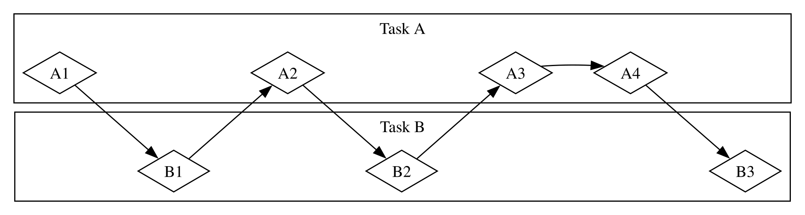
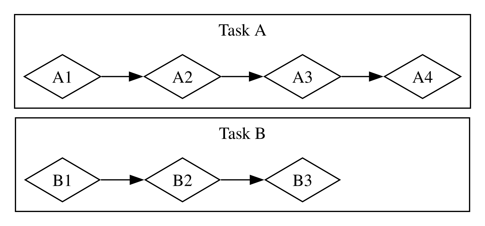
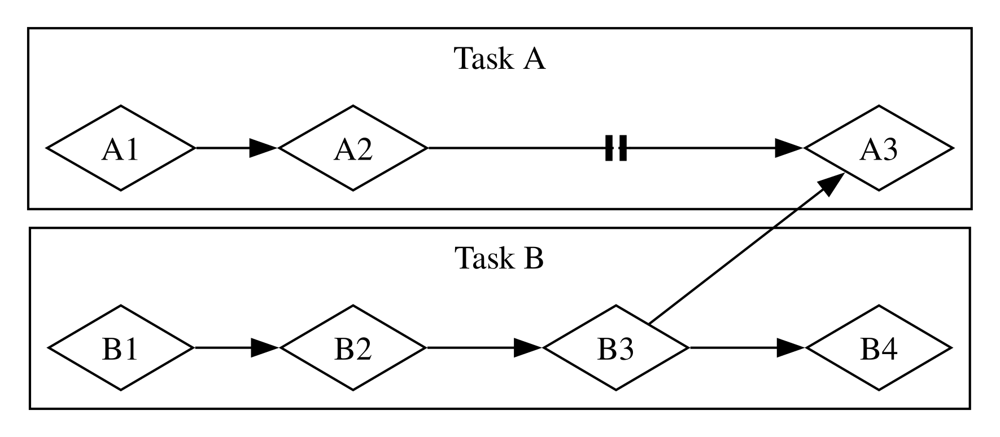

# Dasar-Dasar Pemrograman Asinkron: Async, Await, Futures, dan Streams

Banyak operasi yang kita minta dilakukan komputer butuh waktu untuk selesai. Akan lebih menyenangkan jika kita bisa melakukan hal lain sambil menunggu proses-proses berjalan lama itu selesai. Komputer modern menawarkan dua teknik untuk mengerjakan lebih dari satu operasi dalam satu waktu: _parallelism_ dan _concurrency_. Logika program kita, bagaimanapun juga, ditulis dengan cara yang sebagian besar linier. Kita ingin bisa menentukan operasi apa saja yang harus dilakukan sebuah program, serta titik-titik di mana sebuah fungsi bisa berhenti sejenak sehingga bagian lain dari program bisa berjalan sebagai gantinya—tanpa perlu menentukan terlebih dahulu secara persis urutan dan cara setiap bagian kode harus dijalankan. _Pemrograman asinkron_ adalah abstraksi yang memungkinkan kita mengekspresikan kode dalam bentuk titik-titik jeda yang mungkin terjadi dan hasil akhir yang akan diperoleh, sekaligus mengurus detail koordinasinya untuk kita.

Bab ini melanjutkan pembahasan Bab 16 tentang penggunaan thread untuk parallelism dan concurrency dengan memperkenalkan pendekatan alternatif dalam menulis kode: futures, streams, dan sintaks `async` serta `await` milik Rust yang memungkinkan kita menyatakan bagaimana sebuah operasi bisa bersifat asinkron, serta crate pihak ketiga yang mengimplementasikan runtime asinkron: kode yang mengelola dan mengoordinasikan pelaksanaan operasi asinkron.

Mari kita lihat sebuah contoh. Misalkan kamu sedang mengekspor video yang kamu buat tentang sebuah perayaan keluarga—sebuah operasi yang bisa memakan waktu dari beberapa menit hingga berjam-jam. Ekspor video itu akan memakai daya CPU dan GPU sebanyak mungkin. Seandainya kamu hanya punya satu inti CPU dan sistem operasimu tidak menjeda ekspor itu sampai selesai—artinya, sistem operasi menjalankan ekspor tersebut _synchronously_—kamu tidak bisa melakukan apa pun lagi di komputermu saat tugas itu berjalan. Itu pasti pengalaman yang cukup menjebak. Untungnya, sistem operasi komputermu bisa, dan memang, menyela ekspor itu secara tak terlihat cukup sering sehingga kamu bisa menyelesaikan pekerjaan lain secara bersamaan.

Sekarang misalkan kamu sedang mengunduh video yang dibagikan orang lain, yang juga bisa memakan waktu lama tetapi tidak menyita banyak waktu CPU. Dalam hal ini, CPU harus menunggu data tiba dari jaringan. Meski kamu bisa mulai membaca data begitu data itu mulai datang, bisa jadi butuh waktu sampai semuanya muncul. Bahkan setelah semua data hadir, jika videonya cukup besar, memuat semuanya bisa memakan waktu setidaknya satu atau dua detik. Mungkin terdengar tidak terlalu lama, tetapi bagi prosesor modern yang bisa melakukan miliaran operasi setiap detik, itu waktu yang sangat panjang. Sekali lagi, sistem operasimu akan menyela programmu secara tak terlihat agar CPU bisa mengerjakan hal lain sambil menunggu panggilan jaringan itu selesai.

Ekspor video adalah contoh operasi _CPU-bound_ atau _compute-bound_. Operasi ini dibatasi oleh potensi kecepatan pemrosesan data komputer di dalam CPU atau GPU, dan seberapa besar kecepatan itu bisa dialokasikan untuk operasi tersebut. Unduhan video adalah contoh operasi _I/O-bound_, karena dibatasi oleh kecepatan _input dan output_ komputer; operasi ini hanya bisa berjalan secepat data yang bisa dikirim melalui jaringan.

Pada kedua contoh ini, interupsi tak terlihat dari sistem operasi memberikan bentuk concurrency. Namun, concurrency itu hanya terjadi di level seluruh program: sistem operasi menyela satu program agar program lain bisa menyelesaikan pekerjaannya. Dalam banyak kasus, karena kita memahami program kita jauh lebih detail daripada sistem operasi, kita bisa melihat peluang concurrency yang tidak bisa dilihat sistem operasi.

Misalnya, jika kita sedang membangun alat untuk mengelola unduhan file, kita seharusnya bisa menulis program sedemikian rupa sehingga memulai satu unduhan tidak membuat UI macet, dan pengguna bisa memulai beberapa unduhan secara bersamaan. Akan tetapi, banyak API sistem operasi untuk berinteraksi dengan jaringan bersifat _blocking_; artinya, API itu menahan laju program sampai data yang diprosesnya benar-benar siap.

> Catatan: Kalau kamu pikirkan, beginilah cara kerja _sebagian besar_ panggilan fungsi. Meski demikian, istilah _blocking_ biasanya dipakai khusus untuk panggilan fungsi yang berinteraksi dengan file, jaringan, atau sumber daya lain di komputer, karena dalam kasus-kasus itulah sebuah program akan mendapat manfaat jika operasinya bersifat _non_-blocking.

Kita bisa menghindari pemblokiran thread utama dengan memunculkan thread khusus untuk mengunduh setiap file. Namun, pada akhirnya overhead sumber daya sistem yang dipakai thread-thread itu akan menjadi masalah. Akan lebih baik seandainya panggilan itu sejak awal tidak memblokir, dan sebagai gantinya kita bisa mendefinisikan sejumlah tugas yang ingin diselesaikan program kita lalu membiarkan runtime memilih urutan dan cara terbaik untuk menjalankannya.

Itulah tepatnya yang diberikan abstraksi _async_ (kependekan dari _asynchronous_) milik Rust. Dalam bab ini, kamu akan mempelajari async secara menyeluruh melalui topik-topik berikut:

- Cara memakai sintaks `async` dan `await` milik Rust serta menjalankan fungsi asinkron dengan sebuah runtime
- Cara memakai model async untuk mengatasi sebagian tantangan yang sama seperti yang kita lihat di Bab 16
- Bagaimana multithreading dan async memberikan solusi yang saling melengkapi, yang bisa kamu gabungkan dalam banyak kasus

Sebelum melihat cara kerja async dalam praktiknya, kita perlu sedikit menyimpang untuk membahas perbedaan antara parallelism dan concurrency.

## Parallelism dan Concurrency

Sejauh ini kita memperlakukan parallelism dan concurrency seolah hampir sama. Sekarang kita perlu membedakannya dengan lebih tepat, karena perbedaannya akan muncul begitu kita mulai bekerja.

Perhatikan berbagai cara sebuah tim bisa membagi pekerjaan dalam proyek perangkat lunak. Kamu bisa memberikan beberapa tugas kepada satu anggota, memberi setiap anggota satu tugas, atau memadukan kedua pendekatan itu.

Ketika seseorang mengerjakan beberapa tugas berbeda sebelum salah satunya selesai, itulah _concurrency_. Salah satu cara menerapkan concurrency mirip dengan memiliki dua proyek berbeda yang tersimpan di komputermu, dan saat kamu bosan atau mentok di satu proyek, kamu beralih ke proyek lainnya. Kamu hanya satu orang, jadi kamu tidak bisa maju di kedua tugas pada saat yang persis bersamaan, tetapi kamu bisa melakukan multitasking dengan maju sedikit demi sedikit pada salah satunya dalam satu waktu, lewat perpindahan di antara keduanya (lihat Gambar 17-1).

<figure>

<figcaption>Gambar 17-1: Alur kerja konkuren, berpindah-pindah antara Tugas A dan Tugas B</figcaption>

</figure>

Ketika tim membagi sekelompok tugas dengan cara setiap anggota mengambil satu tugas dan mengerjakannya sendiri-sendiri, itulah _parallelism_. Setiap orang dalam tim bisa maju pada saat yang persis bersamaan (lihat Gambar 17-2).

<figure>

<figcaption>Gambar 17-2: Alur kerja paralel, dengan pekerjaan pada Tugas A dan Tugas B yang berjalan secara mandiri</figcaption>

</figure>

Pada kedua alur kerja ini, kamu mungkin harus mengoordinasikan tugas-tugas yang berbeda. Mungkin kamu mengira tugas yang diberikan kepada seseorang benar-benar mandiri dari pekerjaan orang lain, tetapi ternyata tugas itu memerlukan anggota tim lain untuk menyelesaikan tugasnya terlebih dahulu. Sebagian pekerjaan bisa dilakukan secara paralel, tetapi sebagian lagi sebenarnya _serial_: pekerjaan itu hanya bisa terjadi berurutan, satu tugas demi tugas, seperti pada Gambar 17-3.

<figure>

<figcaption>Gambar 17-3: Alur kerja yang sebagian paralel, dengan pekerjaan pada Tugas A dan Tugas B yang berjalan mandiri hingga Tugas A3 tertahan menunggu hasil dari Tugas B3.</figcaption>

</figure>

Demikian pula, kamu mungkin menyadari bahwa salah satu tugasmu sendiri bergantung pada tugasmu yang lain. Kini pekerjaan konkurenmu juga menjadi serial.

Parallelism dan concurrency juga bisa saling bersilang. Jika kamu mengetahui bahwa seorang rekan kerja tertahan sampai kamu menyelesaikan salah satu tugasmu, kamu mungkin akan memusatkan seluruh tenagamu pada tugas itu untuk “membuka” hambatan rekanmu. Kamu dan rekanmu sudah tidak bisa lagi bekerja secara paralel, dan kamu juga tidak bisa lagi mengerjakan tugas-tugasmu sendiri secara konkuren.

Dinamika dasar yang sama berlaku pada perangkat lunak dan perangkat keras. Pada mesin dengan satu inti CPU, CPU hanya bisa melakukan satu operasi dalam satu waktu, tetapi ia tetap bisa bekerja secara konkuren. Dengan memakai alat-alat seperti thread, proses, dan async, komputer bisa menjeda satu aktivitas dan beralih ke aktivitas lain sebelum akhirnya kembali lagi ke aktivitas pertama itu. Pada mesin dengan beberapa inti CPU, komputer juga bisa bekerja secara paralel. Satu inti bisa mengerjakan sebuah tugas sementara inti lain mengerjakan tugas yang sama sekali tidak terkait, dan operasi itu benar-benar terjadi pada waktu bersamaan.

Menjalankan kode async di Rust biasanya terjadi secara konkuren. Bergantung pada perangkat keras, sistem operasi, dan async runtime yang kita pakai (lebih lanjut tentang async runtime sebentar lagi), concurrency itu juga bisa memakai parallelism di balik layar.

Sekarang, mari kita menyelami cara kerja pemrograman async di Rust sebenarnya.
