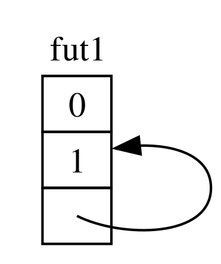
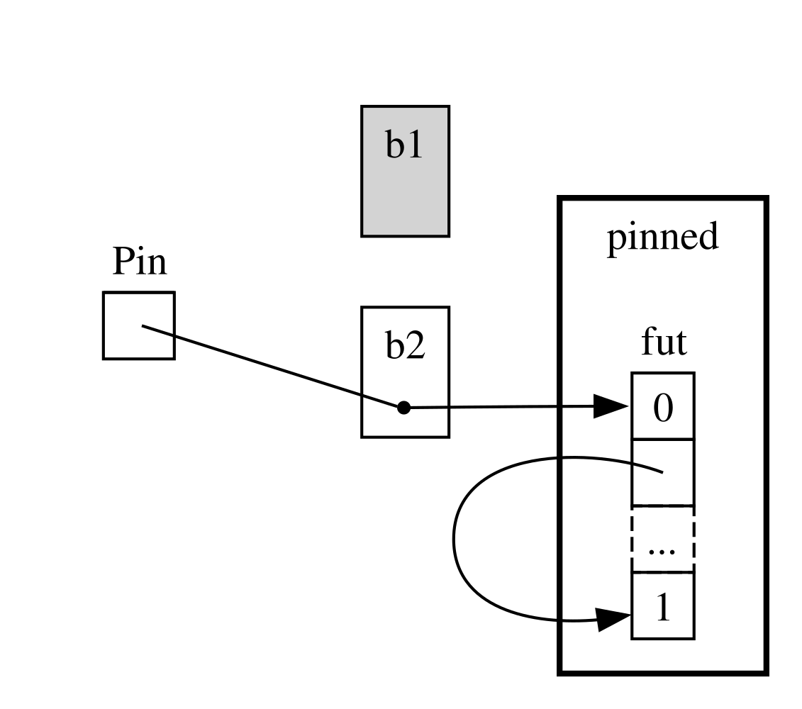
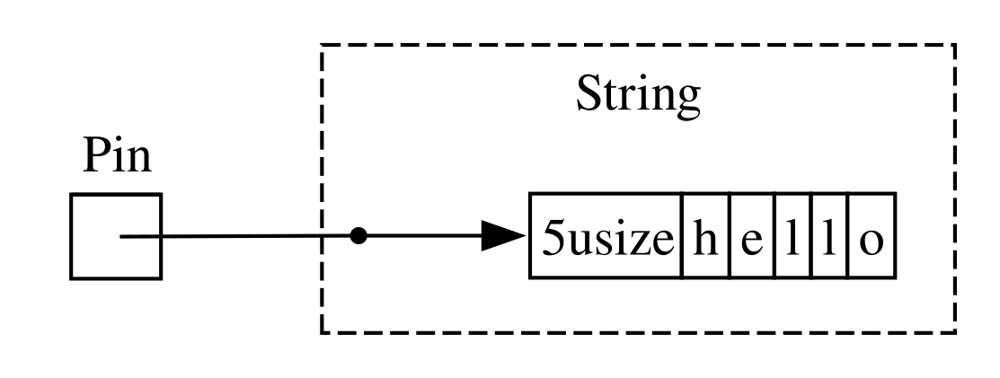
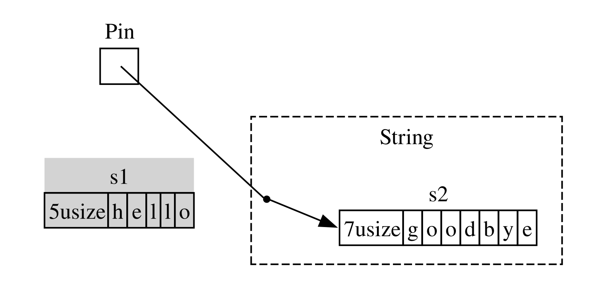

<!-- Old headings. Do not remove or links may break. -->

<a id="digging-into-the-traits-for-async"></a>

## Melihat Lebih Dekat Trait untuk Async

Sepanjang bab ini, kita sudah memakai trait `Future`, `Stream`, dan `StreamExt` dalam berbagai cara. Namun sejauh ini kita sengaja tidak menyelami terlalu jauh detail cara kerja mereka maupun cara mereka saling melengkapi. Untuk pekerjaan Rust sehari-hari, itu biasanya tidak masalah. Kadang-kadang, kamu akan menemui situasi yang menuntut pemahaman lebih detail tentang trait-trait ini, bersama dengan tipe `Pin` dan trait `Unpin`. Di bagian ini, kita akan menggali secukupnya untuk membantu dalam situasi seperti itu, sementara pendalaman yang _benar-benar_ mendalam kita serahkan ke dokumentasi lain.

<!-- Old headings. Do not remove or links may break. -->

<a id="future"></a>

### Trait `Future`

Mari kita mulai dengan melihat lebih dekat cara kerja trait `Future`. Begini cara Rust mendefinisikannya:

```rust
use std::pin::Pin;
use std::task::{Context, Poll};

pub trait Future {
    type Output;

    fn poll(self: Pin<&mut Self>, cx: &mut Context<'_>) -> Poll<Self::Output>;
}
```

Definisi trait ini memuat sejumlah tipe baru dan juga beberapa sintaks yang belum kita lihat, jadi mari kita bahas definisinya bagian demi bagian.

Pertama, tipe asosiasi `Output` pada `Future` menentukan apa yang dihasilkan future tersebut setelah selesai. Ini mirip dengan tipe asosiasi `Item` pada trait `Iterator`. Kedua, `Future` punya method `poll`, yang menerima reference `Pin` khusus untuk parameter `self` serta reference mutable ke tipe `Context`, lalu mengembalikan `Poll<Self::Output>`. Kita akan bicara lebih banyak tentang `Pin` dan `Context` sebentar lagi. Untuk sekarang, mari kita fokus pada apa yang dikembalikan method itu, yaitu tipe `Poll`:

```rust
pub enum Poll<T> {
    Ready(T),
    Pending,
}
```

Tipe `Poll` ini mirip dengan `Option`. Ia punya satu varian yang membawa nilai, `Ready(T)`, dan satu varian yang tidak, `Pending`. Akan tetapi, `Poll` punya makna yang sangat berbeda dari `Option`! Varian `Pending` menunjukkan bahwa future masih punya pekerjaan yang harus dilakukan, jadi pemanggilnya perlu memeriksa lagi nanti. Varian `Ready` menunjukkan bahwa `Future` sudah menyelesaikan pekerjaannya dan nilai `T` sudah tersedia.

> Catatan: Jarang sekali kamu perlu memanggil `poll` langsung, tetapi jika memang perlu, ingat bahwa pada kebanyakan future, pemanggil tidak boleh memanggil `poll` lagi setelah future itu mengembalikan `Ready`. Banyak future yang akan panic jika di-poll lagi setelah menjadi ready. Future yang aman di-poll ulang akan menyebutnya secara eksplisit di dokumentasinya. Ini mirip dengan perilaku `Iterator::next`.

Saat kamu melihat kode yang memakai `await`, Rust mengompilasinya di balik layar menjadi kode yang memanggil `poll`. Jika kamu melihat kembali Listing 17-4, tempat kita mencetak judul halaman untuk satu URL setelah hasilnya tersedia, Rust mengompilasinya menjadi sesuatu yang kurang lebih (meski tidak persis) seperti ini:

```rust,ignore
match page_title(url).poll() {
    Ready(page_title) => match page_title {
        Some(title) => println!("The title for {url} was {title}"),
        None => println!("{url} had no title"),
    }
    Pending => {
        // But what goes here?
    }
}
```

Apa yang harus kita lakukan saat future masih `Pending`? Kita butuh cara untuk mencoba lagi, dan lagi, dan lagi, sampai future itu akhirnya siap. Dengan kata lain, kita butuh loop:

```rust,ignore
let mut page_title_fut = page_title(url);
loop {
    match page_title_fut.poll() {
        Ready(value) => match page_title {
            Some(title) => println!("The title for {url} was {title}"),
            None => println!("{url} had no title"),
        }
        Pending => {
            // continue
        }
    }
}
```

Seandainya Rust mengompilasinya persis menjadi kode itu, setiap `await` akan bersifat blocking—persis kebalikan dari yang kita tuju! Sebaliknya, Rust memastikan loop itu bisa menyerahkan kendali ke sesuatu yang dapat menjeda pekerjaan pada future ini, beralih ke future lain, lalu memeriksa future ini lagi nanti. Seperti yang sudah kita lihat, 'sesuatu' itu adalah async runtime, dan kerja menjadwalkan serta mengoordinasikan ini termasuk tugas utamanya.

Di bagian ["Mengirim Data Antara Dua Task dengan Message Passing"][message-passing]<!-- ignore -->, kita membahas penantian pada `rx.recv`. Panggilan `recv` mengembalikan sebuah future, dan dengan melakukan await pada future itu, kita melakukan poll terhadapnya. Kita sudah menyebut bahwa runtime akan menjeda future tersebut sampai ia siap dengan `Some(message)` atau `None` saat channel ditutup. Dengan pemahaman kita yang lebih dalam tentang trait `Future`, khususnya `Future::poll`, kita bisa melihat bagaimana hal itu bekerja. Runtime tahu future itu belum siap ketika ia mengembalikan `Poll::Pending`. Sebaliknya, runtime tahu future itu _memang_ sudah siap dan memajukannya ketika `poll` mengembalikan `Poll::Ready(Some(message))` atau `Poll::Ready(None)`.

Detail persis tentang cara runtime melakukan itu berada di luar cakupan buku ini, tetapi intinya adalah memahami mekanika dasar future: sebuah runtime melakukan _poll_ pada setiap future yang menjadi tanggung jawabnya, dan menidurkan kembali future tersebut ketika ia belum siap.

<!-- Old headings. Do not remove or links may break. -->

<a id="pinning-and-the-pin-and-unpin-traits"></a>
<a id="the-pin-and-unpin-traits"></a>

### Tipe `Pin` dan Trait `Unpin`

Kembali ke Listing 17-13, kita memakai macro `trpl::join!` untuk melakukan await pada tiga future. Namun, lumrah jika kita punya koleksi seperti vector yang berisi sejumlah future yang baru diketahui jumlahnya saat runtime. Mari kita ubah Listing 17-13 menjadi kode di Listing 17-23 yang memasukkan ketiga future itu ke dalam sebuah vector dan sebagai gantinya memanggil fungsi `trpl::join_all` — yang belum akan terkompilasi.

<Listing number="17-23" caption="Melakukan await pada future dalam sebuah koleksi" file-name="src/main.rs">

```rust,ignore,does_not_compile
{{#rustdoc_include ../listings/ch17-async-await/listing-17-23/src/main.rs:here}}
```

</Listing>

Kita membungkus setiap future dalam `Box` untuk menjadikannya _trait object_, sama seperti yang kita lakukan di bagian "Mengembalikan Error dari `run`" di Bab 12. (Kita akan membahas trait object secara rinci di Bab 18.) Memakai trait object memungkinkan kita memperlakukan setiap future anonim yang dihasilkan oleh tipe-tipe ini seolah-olah berupa tipe yang sama, karena semuanya mengimplementasikan trait `Future`.

Ini mungkin mengejutkan. Bagaimanapun, tidak ada blok async yang mengembalikan apa pun, sehingga masing-masing menghasilkan `Future<Output = ()>`. Namun ingat bahwa `Future` adalah trait, dan compiler membuat enum yang unik untuk setiap blok async, bahkan ketika tipe output-nya identik. Sama seperti kamu tidak bisa memasukkan dua struct buatan tangan yang berbeda ke dalam sebuah `Vec`, kamu juga tidak bisa mencampur enum yang dihasilkan compiler.

Lalu kita meneruskan koleksi future itu ke fungsi `trpl::join_all` dan melakukan await pada hasilnya. Namun, kode ini tidak terkompilasi; berikut bagian yang relevan dari pesan error-nya.

<!-- manual-regeneration
cd listings/ch17-async-await/listing-17-23
cargo build
copy *only* the final `error` block from the errors
-->

```text
error[E0277]: `dyn Future<Output = ()>` cannot be unpinned
  --> src/main.rs:48:33
   |
48 |         trpl::join_all(futures).await;
   |                                 ^^^^^ the trait `Unpin` is not implemented for `dyn Future<Output = ()>`
   |
   = note: consider using the `pin!` macro
           consider using `Box::pin` if you need to access the pinned value outside of the current scope
   = note: required for `Box<dyn Future<Output = ()>>` to implement `Future`
note: required by a bound in `futures_util::future::join_all::JoinAll`
  --> file:///home/.cargo/registry/src/index.crates.io-1949cf8c6b5b557f/futures-util-0.3.30/src/future/join_all.rs:29:8
   |
27 | pub struct JoinAll<F>
   |            ------- required by a bound in this struct
28 | where
29 |     F: Future,
   |        ^^^^^^ required by this bound in `JoinAll`
```

Catatan dalam pesan error ini memberi tahu kita bahwa kita sebaiknya memakai macro `pin!` untuk melakukan _pin_ pada nilai-nilai tersebut, yang berarti memasukkannya ke dalam tipe `Pin` yang menjamin nilai itu tidak akan dipindahkan di memori. Pesan error itu mengatakan pinning diperlukan karena `dyn Future<Output = ()>` perlu mengimplementasikan trait `Unpin`, dan saat ini belum.

Fungsi `trpl::join_all` mengembalikan struct bernama `JoinAll`. Struct itu bersifat generic atas tipe `F`, yang dibatasi untuk mengimplementasikan trait `Future`. Melakukan await langsung pada sebuah future dengan `await` akan melakukan pin secara implisit. Itulah sebabnya kita tidak perlu memakai `pin!` di setiap tempat yang ingin melakukan await pada future.

Namun di sini kita tidak melakukan await langsung pada sebuah future. Sebaliknya, kita membentuk future baru, JoinAll, dengan meneruskan koleksi future ke fungsi `join_all`. Signature `join_all` mensyaratkan bahwa semua tipe item dalam koleksi mengimplementasikan trait `Future`, dan `Box<T>` mengimplementasikan `Future` hanya jika `T` yang dibungkusnya adalah future yang mengimplementasikan trait `Unpin`.

Itu banyak sekali yang harus dicerna! Untuk benar-benar memahaminya, mari kita selami sedikit lebih jauh cara kerja trait `Future` sebenarnya, khususnya seputar pinning. Lihat lagi definisi trait `Future`:

```rust
use std::pin::Pin;
use std::task::{Context, Poll};

pub trait Future {
    type Output;

    // Required method
    fn poll(self: Pin<&mut Self>, cx: &mut Context<'_>) -> Poll<Self::Output>;
}
```

Parameter `cx` dan tipe `Context`-nya adalah kunci bagaimana runtime benar-benar tahu kapan harus memeriksa suatu future sambil tetap bersifat lazy. Sekali lagi, detail cara kerjanya berada di luar cakupan bab ini, dan kamu umumnya hanya perlu memikirkannya saat menulis implementasi `Future` sendiri. Kita akan fokus pada tipe `self`, karena ini pertama kalinya kita melihat method yang memberi anotasi tipe pada `self`. Anotasi tipe untuk `self` bekerja seperti anotasi tipe pada parameter fungsi lainnya, tetapi dengan dua perbedaan utama:

- Anotasi itu memberi tahu Rust tipe apa `self` harus agar method tersebut bisa dipanggil.
- Tipenya tidak bisa sembarangan. Ia dibatasi pada tipe tempat method itu diimplementasikan, reference atau smart pointer ke tipe itu, atau `Pin` yang membungkus reference ke tipe tersebut.

Kita akan melihat lebih banyak tentang sintaks ini di [Bab 18][ch-18]<!-- ignore -->. Untuk sekarang, cukup tahu bahwa jika kita ingin melakukan poll pada sebuah future untuk memeriksa apakah ia `Pending` atau `Ready(Output)`, kita membutuhkan reference mutable yang dibungkus `Pin` ke tipe tersebut.

`Pin` adalah pembungkus untuk tipe-tipe yang menyerupai pointer seperti `&`, `&mut`, `Box`, dan `Rc`. (Secara teknis, `Pin` bekerja dengan tipe yang mengimplementasikan trait `Deref` atau `DerefMut`, tetapi pada dasarnya itu setara dengan hanya bekerja pada reference dan smart pointer.) `Pin` sendiri bukan sebuah pointer dan tidak punya perilaku sendiri seperti `Rc` dan `Arc` dalam hal reference counting; ia murni alat yang bisa dipakai compiler untuk memberlakukan batasan pada penggunaan pointer.

Dengan mengingat bahwa `await` diimplementasikan lewat panggilan ke `poll`, kita mulai bisa menjelaskan pesan error yang kita lihat tadi—meskipun pesan itu memakai istilah `Unpin`, bukan `Pin`. Jadi, bagaimana tepatnya `Pin` berhubungan dengan `Unpin`, dan mengapa `Future` memerlukan `self` berada di dalam tipe `Pin` agar `poll` bisa dipanggil?

Ingat dari awal bab ini bahwa rangkaian titik await dalam sebuah future dikompilasi menjadi mesin keadaan (state machine), dan compiler memastikan mesin keadaan itu mengikuti semua aturan normal Rust tentang keamanan, termasuk borrowing dan *ownership*. Agar bisa melakukan itu, Rust melihat data apa yang dibutuhkan antara satu titik await dan titik await berikutnya atau akhir dari blok async. Lalu ia membuat varian yang sesuai dalam mesin keadaan hasil kompilasi. Setiap varian mendapat akses yang diperlukan ke data yang akan dipakai di bagian kode sumber itu, baik dengan mengambil ownership data tersebut maupun dengan mendapatkan reference mutable atau immutable ke data itu.

Sejauh ini baik saja: jika ada yang salah terkait ownership atau reference dalam sebuah blok async, borrow checker akan memberi tahu kita. Namun saat kita ingin memindahkan future yang bersesuaian dengan blok itu—misalnya memindahkannya ke dalam `Vec` untuk diteruskan ke `join_all`—urusan menjadi lebih rumit.

Saat kita memindahkan sebuah future—baik dengan memasukkannya ke dalam struktur data untuk dipakai sebagai iterator bersama `join_all`, maupun dengan mengembalikannya dari sebuah fungsi—itu sebenarnya berarti memindahkan mesin keadaan yang dibuat Rust untuk kita. Dan tidak seperti kebanyakan tipe lain di Rust, future yang dibuat Rust untuk blok async bisa saja memiliki reference ke dirinya sendiri di field dari salah satu varian, seperti yang ditunjukkan ilustrasi sederhana di Gambar 17-4.

<figure>



<figcaption>Gambar 17-4: Tipe data yang mereferensikan dirinya sendiri</figcaption>

</figure>

Namun secara bawaan, objek apa pun yang memiliki reference ke dirinya sendiri tidak aman untuk dipindahkan, karena reference selalu menunjuk ke alamat memori asli dari apa pun yang direferensikannya (lihat Gambar 17-5). Jika kamu memindahkan struktur data itu sendiri, reference internal tersebut akan tetap menunjuk ke lokasi lama. Padahal, lokasi memori itu kini sudah tidak valid. Pertama, nilainya tidak akan ikut diperbarui saat kamu mengubah struktur data itu. Kedua—dan ini lebih penting—komputer kini bebas memakai ulang memori itu untuk keperluan lain! Bisa jadi kamu nanti justru membaca data yang sama sekali tidak berkaitan.

<figure>


<figcaption>Gambar 17-5: Hasil yang tidak aman saat memindahkan tipe data yang mereferensikan dirinya sendiri</figcaption>

</figure>

Secara teori, compiler Rust bisa saja mencoba memperbarui setiap reference ke sebuah objek setiap kali objek itu dipindahkan, tetapi itu bisa menambah beban kinerja yang besar, apalagi jika seluruh jaringan reference perlu diperbarui. Seandainya kita bisa memastikan struktur data yang bersangkutan _tidak berpindah di memori_, kita tidak perlu memperbarui reference apa pun. Itu persis yang dilakukan borrow checker Rust: dalam kode aman, ia mencegahmu memindahkan item apa pun yang masih memiliki reference aktif ke dalamnya.

`Pin` membangun di atas itu untuk memberi jaminan persis yang kita butuhkan. Saat kita melakukan _pin_ pada sebuah nilai dengan membungkus pointer ke nilai itu dalam `Pin`, nilai tersebut tidak bisa lagi dipindahkan. Jadi, jika kamu punya `Pin<Box<SomeType>>`, yang kamu pin sebenarnya adalah nilai `SomeType`, _bukan_ pointer `Box`. Gambar 17-6 mengilustrasikan proses ini.

<figure>


<figcaption>Gambar 17-6: Melakukan pin pada `Box` yang menunjuk ke tipe future yang mereferensikan dirinya sendiri</figcaption>

</figure>

Faktanya, pointer `Box` itu masih boleh bergerak bebas. Ingat: yang kita pedulikan adalah memastikan data yang akhirnya direferensikan tetap di tempatnya. Jika sebuah pointer berpindah, _tetapi data yang ditunjuknya_ tetap di lokasi yang sama, seperti di Gambar 17-7, tidak ada masalah potensial. (Sebagai latihan mandiri, lihat dokumentasi untuk tipe-tipe tersebut serta modul `std::pin`, lalu cari tahu bagaimana kamu akan melakukan ini dengan `Pin` yang membungkus `Box`.) Kuncinya adalah tipe yang mereferensikan dirinya sendiri tidak boleh bergerak, karena ia tetap dalam keadaan ter-pin.

<figure>



<figcaption>Gambar 17-7: Memindahkan `Box` yang menunjuk ke tipe future yang mereferensikan dirinya sendiri</figcaption>

</figure>

Meski begitu, kebanyakan tipe sama sekali aman untuk dipindahkan, bahkan jika kebetulan berada di balik pointer `Pin`. Kita hanya perlu memikirkan pinning ketika suatu item punya reference internal. Nilai primitif seperti angka dan Boolean aman karena jelas tidak punya reference internal. Begitu juga kebanyakan tipe yang biasa kamu pakai di Rust. Kamu bisa memindahkan `Vec`, misalnya, tanpa khawatir. Melihat apa yang sudah kita lihat sejauh ini, jika kamu punya `Pin<Vec<String>>`, kamu harus melakukan semuanya lewat API yang aman tetapi membatasi dari `Pin`, padahal `Vec<String>` selalu aman dipindahkan jika tidak ada reference lain ke dalamnya. Kita butuh cara untuk memberi tahu compiler bahwa dalam kasus seperti ini boleh saja memindahkan item—dan di situlah `Unpin` berperan.

`Unpin` adalah marker trait, mirip dengan trait `Send` dan `Sync` yang kita lihat di Bab 16, sehingga tidak punya fungsionalitas sendiri. Marker trait ada hanya untuk memberi tahu compiler bahwa aman memakai tipe yang mengimplementasikan trait tertentu dalam konteks tertentu. `Unpin` memberi tahu compiler bahwa tipe tertentu _tidak_ perlu menjaga jaminan apa pun tentang apakah nilai yang bersangkutan bisa dipindahkan dengan aman.

<!--
  The inline `<code>` in the next block is to allow the inline `<em>` inside it,
  matching what NoStarch does style-wise, and emphasizing within the text here
  that it is something distinct from a normal type.
-->

Sama seperti `Send` dan `Sync`, compiler mengimplementasikan `Unpin` secara otomatis untuk semua tipe yang bisa dibuktikan aman. Kasus khususnya—sekali lagi mirip dengan `Send` dan `Sync`—adalah ketika `Unpin` _tidak_ diimplementasikan untuk sebuah tipe. Notasinya adalah <code>impl !Unpin for <em>SomeType</em></code>, dengan <code><em>SomeType</em></code> sebagai nama tipe yang _memang_ perlu menjaga jaminan itu agar aman setiap kali pointer ke tipe tersebut dipakai dalam `Pin`.

Dengan kata lain, ada dua hal yang perlu diingat tentang hubungan antara `Pin` dan `Unpin`. Pertama, `Unpin` adalah kasus "normal", sedangkan `!Unpin` adalah kasus khusus. Kedua, apakah sebuah tipe mengimplementasikan `Unpin` atau `!Unpin` _hanya_ berarti ketika kamu memakai pointer ter-pin ke tipe itu seperti <code>Pin<&mut
<em>SomeType</em>></code>.

Agar lebih konkret, pikirkan `String`: ia punya panjang dan karakter Unicode yang menyusunnya. Kita bisa membungkus `String` dalam `Pin`, seperti terlihat di Gambar 17-8. Namun, `String` secara otomatis mengimplementasikan `Unpin`, seperti juga kebanyakan tipe lain di Rust.

<figure>



<figcaption>Gambar 17-8: Melakukan pin pada `String`; garis putus-putus menandakan bahwa `String` mengimplementasikan trait `Unpin` dan dengan demikian tidak ter-pin</figcaption>

</figure>

Hasilnya, kita bisa melakukan hal-hal yang akan melanggar aturan seandainya `String` mengimplementasikan `!Unpin`, seperti mengganti satu string dengan string lain di lokasi memori yang persis sama seperti di Gambar 17-9. Ini tidak melanggar kontrak `Pin`, karena `String` tidak punya reference internal yang membuatnya tidak aman untuk dipindahkan. Itu persis alasan ia mengimplementasikan `Unpin`, bukan `!Unpin`.

<figure>



<figcaption>Gambar 17-9: Mengganti `String` dengan `String` yang sama sekali berbeda di memori</figcaption>

</figure>

Kini kita sudah cukup tahu untuk memahami error yang dilaporkan untuk panggilan `join_all` di Listing 17-23 tadi. Awalnya kita mencoba memindahkan future yang dihasilkan blok async ke dalam `Vec<Box<dyn Future<Output = ()>>>`, tetapi seperti yang sudah kita lihat, future-future itu bisa memiliki reference internal, sehingga tidak otomatis mengimplementasikan `Unpin`. Setelah kita melakukan pin pada mereka, kita bisa memasukkan tipe `Pin` yang dihasilkan ke dalam `Vec`, dengan yakin bahwa data yang mendasari future itu _tidak_ akan dipindahkan. Listing 17-24 menunjukkan cara memperbaiki kode dengan memanggil macro `pin!` di tempat ketiga future itu didefinisikan dan menyesuaikan tipe trait object-nya.

<Listing number="17-24" caption="Melakukan pin pada future agar bisa dipindahkan ke dalam vector">

```rust
{{#rustdoc_include ../listings/ch17-async-await/listing-17-24/src/main.rs:here}}
```

</Listing>

Contoh ini sekarang bisa dikompilasi dan dijalankan, dan kita bisa menambah atau menghapus future dari vector saat runtime lalu menggabungkan semuanya.

`Pin` dan `Unpin` lebih banyak berperan saat membangun library level rendah, atau ketika kamu sedang membangun runtime itu sendiri, alih-alih dalam kode Rust sehari-hari. Namun, ketika kamu melihat trait-trait ini di pesan error, kini kamu punya gambaran yang lebih baik tentang cara memperbaiki kodemu!

> Catatan: Kombinasi `Pin` dan `Unpin` ini memungkinkan kita mengimplementasikan dengan aman seluruh kelas tipe kompleks di Rust yang tanpa itu akan sulit dikerjakan karena sifatnya yang mereferensikan dirinya sendiri. Saat ini, tipe yang memerlukan `Pin` paling sering muncul di Rust async, tetapi sesekali kamu juga bisa menjumpainya dalam konteks lain.
>
> Detail cara kerja `Pin` dan `Unpin` serta aturan yang harus mereka jaga dibahas secara mendalam di dokumentasi API untuk `std::pin`, jadi jika kamu ingin belajar lebih banyak, itu tempat yang baik untuk memulai.
>
> Jika kamu ingin memahami cara kerja di balik layar secara lebih rinci lagi, lihat Bab [2][under-the-hood]<!-- ignore --> dan [4][pinning]<!-- ignore --> dari [_Asynchronous Programming in Rust_][async-book].

### Trait `Stream`

Sekarang setelah kamu punya pemahaman yang lebih dalam tentang trait `Future`, `Pin`, dan `Unpin`, kita bisa beralih ke trait `Stream`. Seperti yang kamu pelajari sebelumnya dalam bab ini, stream mirip dengan iterator asinkron. Namun, tidak seperti `Iterator` dan `Future`, `Stream` belum punya definisi di library standar pada saat buku ini ditulis, tetapi _ada_ definisi yang sangat umum dari crate `futures` yang dipakai di seluruh ekosistem.

Mari kita tinjau ulang definisi trait `Iterator` dan `Future` sebelum melihat bagaimana trait `Stream` mungkin menggabungkan keduanya. Dari `Iterator`, kita punya gagasan tentang urutan: method `next`-nya menyediakan `Option<Self::Item>`. Dari `Future`, kita punya gagasan tentang kesiapan dari waktu ke waktu: method `poll`-nya menyediakan `Poll<Self::Output>`. Untuk merepresentasikan urutan item yang menjadi siap dari waktu ke waktu, kita mendefinisikan trait `Stream` yang menyatukan kedua fitur itu:

```rust
use std::pin::Pin;
use std::task::{Context, Poll};

trait Stream {
    type Item;

    fn poll_next(
        self: Pin<&mut Self>,
        cx: &mut Context<'_>
    ) -> Poll<Option<Self::Item>>;
}
```

Trait `Stream` mendefinisikan tipe asosiasi bernama `Item` untuk tipe item yang dihasilkan stream. Ini mirip dengan `Iterator`, yang bisa menghasilkan nol hingga banyak item, dan berbeda dari `Future`, yang selalu punya satu `Output`, meskipun itu berupa tipe unit `()`.

`Stream` juga mendefinisikan method untuk mengambil item-item itu. Kita menyebutnya `poll_next` agar jelas bahwa ia melakukan poll dengan cara yang sama seperti `Future::poll` dan menghasilkan urutan item dengan cara yang sama seperti `Iterator::next`. Tipe kembaliannya menggabungkan `Poll` dan `Option`. Tipe luarnya adalah `Poll`, karena harus diperiksa kesiapannya, sama seperti future. Tipe dalamnya adalah `Option`, karena perlu menandakan apakah masih ada pesan lagi, sama seperti iterator.

Sesuatu yang sangat mirip dengan definisi ini kemungkinan besar akan akhirnya menjadi bagian dari library standar Rust. Sementara itu, definisi ini sudah menjadi bagian dari peralatan kebanyakan runtime, jadi kamu bisa mengandalkannya, dan semua yang kita bahas selanjutnya umumnya tetap berlaku!

Pada contoh-contoh yang kita lihat di bagian ["Stream: Future dalam Urutan"][streams]<!-- ignore -->, kita tidak memakai `poll_next` _maupun_ `Stream`, melainkan `next` dan `StreamExt`. Tentu saja kita _bisa_ bekerja langsung dengan API `poll_next` dengan menulis sendiri mesin keadaan `Stream` kita, sama seperti kita _bisa_ bekerja langsung dengan future lewat method `poll`-nya. Namun, memakai `await` jauh lebih nyaman, dan trait `StreamExt` menyediakan method `next` sehingga kita bisa melakukan persis itu:

```rust
{{#rustdoc_include ../listings/ch17-async-await/no-listing-stream-ext/src/lib.rs:here}}
```

<!--
TODO: update this if/when tokio/etc. update their MSRV and switch to using async functions
in traits, since the lack thereof is the reason they do not yet have this.
-->

> Catatan: Definisi yang sebenarnya kita pakai sebelumnya dalam bab ini tampak sedikit berbeda dari ini, karena definisi itu mendukung versi Rust yang belum mendukung pemakaian fungsi async di dalam trait. Akibatnya, definisinya terlihat seperti ini:
>
> ```rust,ignore
> fn next(&mut self) -> Next<'_, Self> where Self: Unpin;
> ```
>
> Tipe `Next` adalah `struct` yang mengimplementasikan `Future` dan memungkinkan kita menyebut lifetime dari reference ke `self` dengan `Next<'_, Self>`, sehingga `await` bisa bekerja dengan method ini.

Trait `StreamExt` juga menjadi tempat berkumpulnya semua method menarik yang bisa dipakai dengan stream. `StreamExt` diimplementasikan secara otomatis untuk setiap tipe yang mengimplementasikan `Stream`, tetapi kedua trait ini didefinisikan terpisah agar komunitas bisa menyempurnakan API kenyamanan tanpa memengaruhi trait dasarnya.

Pada versi `StreamExt` yang dipakai dalam crate `trpl`, trait itu tidak hanya mendefinisikan method `next`, tetapi juga menyediakan implementasi bawaan `next` yang menangani detail pemanggilan `Stream::poll_next` dengan benar. Ini berarti bahkan ketika kamu perlu menulis tipe data streaming sendiri, kamu _hanya_ perlu mengimplementasikan `Stream`, dan siapa pun yang memakai tipe datamu bisa otomatis memakai `StreamExt` beserta method-methodnya.

Itu saja yang akan kita bahas tentang detail level rendah dari trait-trait ini. Sebagai penutup, mari kita lihat bagaimana future (termasuk stream), task, dan thread semuanya saling terhubung!

[message-passing]: ch17-02-concurrency-with-async.md#sending-data-between-two-tasks-using-message-passing
[ch-18]: ch18-00-oop.html
[async-book]: https://rust-lang.github.io/async-book/
[under-the-hood]: https://rust-lang.github.io/async-book/02_execution/01_chapter.html
[pinning]: https://rust-lang.github.io/async-book/04_pinning/01_chapter.html
[first-async]: ch17-01-futures-and-syntax.html#our-first-async-program
[any-number-futures]: ch17-03-more-futures.html#working-with-any-number-of-futures
[streams]: ch17-04-streams.html
