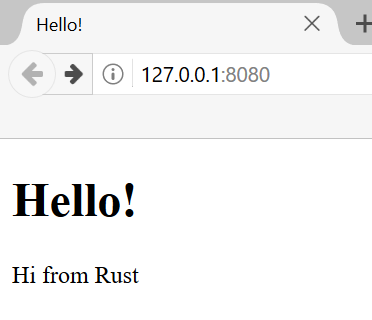

# Proyek Akhir: Membangun Web Server Multithread

Perjalanan ini panjang, tapi kita akhirnya sampai juga di akhir buku. Di bab ini, kita akan membangun satu proyek lagi bersama-sama untuk mendemonstrasikan beberapa konsep yang kita bahas di bab-bab terakhir, sekaligus mengulang beberapa pelajaran sebelumnya.

Untuk proyek akhir kita, kita akan membuat web server yang menampilkan "Hello!" dan tampak seperti Gambar 21-1 di browser web.

Berikut rencana kita untuk membangun web server itu:

1. Pelajari sedikit tentang TCP dan HTTP.
2. Dengarkan koneksi TCP pada sebuah socket.
3. Mengurai sejumlah kecil request HTTP.
4. Buat response HTTP yang tepat.
5. Tingkatkan throughput server kita dengan thread pool.

Gambar 21-1: Proyek bersama terakhir kita

Sebelum mulai, ada dua hal yang perlu kita sampaikan. Pertama, cara yang akan kita pakai bukanlah cara terbaik untuk membangun web server dengan Rust. Anggota komunitas sudah menerbitkan sejumlah crate siap pakai untuk produksi yang tersedia di [crates.io](https://crates.io/) dan menyediakan implementasi web server serta thread pool yang lebih lengkap daripada yang akan kita bangun. Namun, maksud kita di bab ini adalah membantumu belajar, bukan mengambil jalan pintas. Karena Rust adalah bahasa pemrograman sistem, kita bisa memilih level abstraksi yang ingin kita pakai dan turun ke level yang lebih rendah daripada yang mungkin atau praktis dilakukan di bahasa lain.

Kedua, kita tidak akan memakai async and await di sini. Membangun thread pool saja sudah cukup menantang, apalagi harus ditambah dengan membangun async runtime! Meski begitu, kita akan mencatat bagaimana async and await bisa diterapkan pada beberapa masalah yang sama yang akan kita lihat di bab ini. Pada akhirnya, seperti yang kita singgung di Bab 17, banyak async runtime memakai thread pool untuk mengelola pekerjaan mereka.

Jadi, kita akan menulis HTTP server dan thread pool dasar ini secara manual supaya kamu bisa mempelajari ide dan teknik umum di balik crate-crate yang mungkin akan kamu pakai di kemudian hari.
